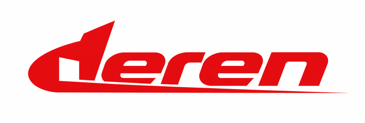
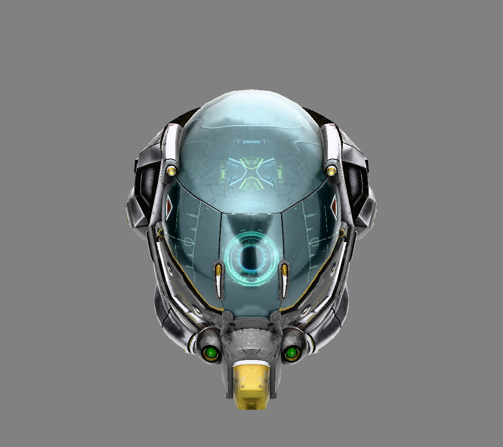
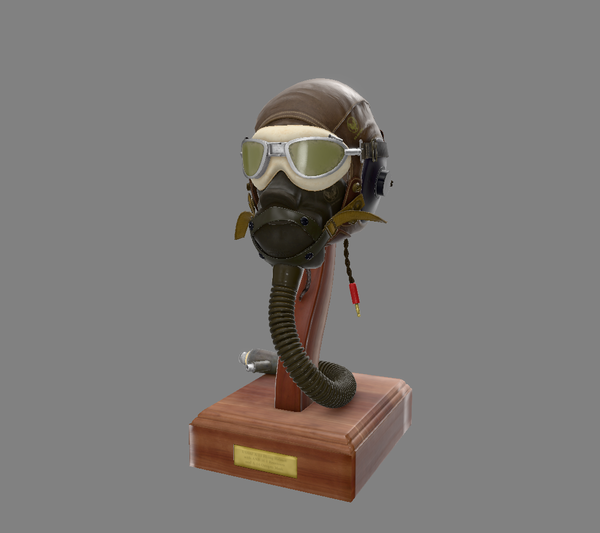
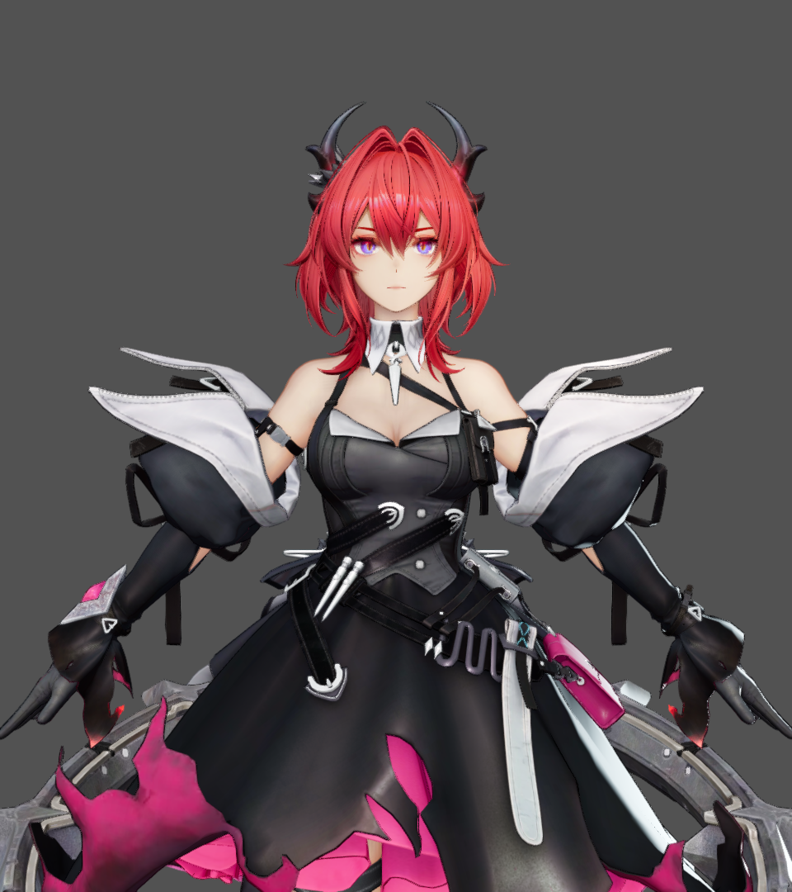
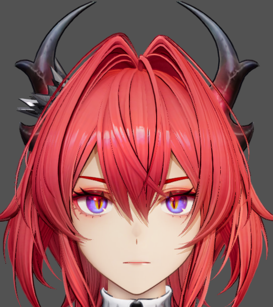

<p align="center">
  <picture>
    <source media="(prefers-color-scheme: dark)" srcset="docs/images/branding/deren-logo-dark-720.png">
    <source media="(prefers-color-scheme: light)" srcset="docs/images/branding/deren-logo-light-720.png">
    
  </picture>
</p>

**deren** is a real-time renderer built around current C++ and graphics APIs. The engine is portable: it talks to graphics implementations through RHI and GUI contracts and loads them as DLLs. The current baseline combines C++26 modules, deferred PBR, toon shading, Gaussian splatting, Slang shaders, and a backend-independent RHI with a Vulkan backend.

> The project was renamed from `vulkan_render` to `deren` on 2026-10-02. Portable modules use `deren.engine.*` / `deren::engine`; native Vulkan implementations keep `deren.vulkan.*` / `deren::vulkan`.


[Gaussian splatting details](#gaussian-splatting).

<p align="center">
  
  
</p>

<p align="center">
  
  
</p>

<sub>DamagedHelmet and FlightHelmet use deferred PBR with Studio Neutral HDR lighting and Khronos PBR Neutral tone mapping; DamagedHelmet adds ray-traced reflections. The Laevatain shots use the GameToon profile with its captured light rig. See [`docs/screenshots/README.md`](docs/screenshots/README.md) for capture settings.</sub>

## Features

- **Engine runtime and modular boundaries**: `deren.engine.runtime` owns the scene-wide GPU resources and drives a frame through explicit phases (`poll_events`, `pace_and_acquire`, `begin_recording`, `record_main_drawcalls`, `end_recording`, `submit_and_present`). CPU-only modules such as `deren.gltf_loader`, `deren.application_configuration` and `deren.utility` do not depend on Vulkan; the backend is loaded through `deren.engine.backend_loader`.
- **Scene and draw model**: a caller-owned scene tree is walked once per frame into world matrices; GPU drawables live in `deren.engine.primitive`. Leaves either use default pipeline semantics or request a named pipeline, so several pipelines and material strategies coexist in one scene. Parallel recording workers each build their own `render_environment`. A BVH over leaf bounds culls the scene against the camera and is reused while the scene and camera are static; `static_draw_primitive` merges static sub-meshes into one vertex/index buffer with a per-chunk draw table.
- **Vulkan 1.3 backend**: dynamic rendering (no render passes or framebuffers), a descriptor heap instead of descriptor sets, timeline semaphores, ray queries, mesh/task shaders, host image copies, and buffer device addresses. The RHI/GUI boundary is process-level and backend implementations are loaded by name.
- **Deferred rendering**: a G-buffer pass writes surface targets; the lighting stage shades them into an HDR target with IBL, punctual lights, cascaded shadows and optional ray-traced sun shadows. Post-processing adds exposure, ACES tone mapping, bloom and FXAA; TAA is available separately. The analytic `furnace` mode is an exactness check for the lighting path.
- **Lighting and effects**: metallic-roughness PBR with five texture slots and glTF alpha modes; GGX/Smith by default with selectable direct-light BRDFs; prefiltered environment maps and a BRDF LUT; 1-4 cascaded shadow maps with PCF; clustered light culling; hemisphere-sampling SSAO; ray-traced reflections for PBR and toon materials.
- **subtilis geometry LOD**: visibility buffer + Cluster DAG LOD + HZB occlusion/recovery is the shipping path. DAG+HZB remains the accepted optimization; the software-raster lane is experimental, opt-in and default-off. **M2 GPU cut** (`[render] subtilis_gpu_cut`) is implemented but **off by default**: a persistent-workgroup compute shader selects the cut and writes the indirect command for static, non-skinned, non-morphed meshes on the 80-byte vertex layout, with hysteresis, HZB and software raster disabled. `test_subtilis_cut_gpu` checks parity against the CPU oracle. On textured Bistro at 1280x720 the GPU path dispatched 251 of 2906 items and produced a byte-identical image to the CPU cut, but the frame remained GPU-bound (46.2 fps vs 46.0-46.3 fps); the value is CPU headroom and scale, not a current FPS win. M5a/M5b add an offline page table and a synchronous residency manager; M5c requests cut pages, installs them under a fixed budget on the next frame, and falls back to LOD0 until they are resident. Device-to-device page copies and eviction are not implemented yet. See [the subtilis overview](docs/subtilis.md) and [the M2/M5 plan](docs/subtilis_m2_m5_plan.md).
- **amnis texture residency**: an opt-in texture-residency system independent of the geometry cuts. Visibility and screen-footprint feedback request whole-image, two-tier or progressive mip streaming; bounded async uploads and low-resolution fallbacks keep frames moving. See [`docs/amnis.md`](docs/amnis.md).
- **Gaussian splatting**: `.ply` files load as Gaussian clouds, are packed onto the GPU once, and are drawn by a dedicated stage between lighting and blended geometry. The GPU path prepares, sorts, finalizes and rasterizes without CPU readback.
- **glTF, animation and skinning**: `.gltf` / `.glb` loading with hierarchy, skins, morph targets and keyframe animations; a format-neutral animation controller samples into the scene tree and updates skin/morph buffers per frame.
- **Debug GUI, profiling and capture**: a Dear ImGui overlay (F1) exposes only features that can affect the current frame. `[render] gpu_timings` records pass boundaries with `vkCmdWriteTimestamp` without waiting on the GPU. F12 saves a PNG through the frame's own command buffer; `--capture-frames`, `--capture-camera`, `--capture-sweep` and `--capture-animation-sweep` make headless captures reproducible.
- **Engineering**: C++26 modules, exceptions and RTTI disabled, `-Wall -Wextra -Werror`, automatic `clang-format`, LTO and dead-code elimination in Release, and a per-module CMake target graph.

## Build helpers

The repository ships platform **setup** scripts and unified Python **build / run / documentation** entry points under `scripts/build_helpers/` (Python 3.8+). Setup stays a shell script because it installs the toolchain that provides Python. The same entry points exist on **Windows** (MSYS2 clang64) and **POSIX** (Linux / WSL / macOS), but only Windows is built by CI; POSIX is source-tree support, not a verified configuration.

Commit and CI rules are in [`CONTRIBUTING.md`](CONTRIBUTING.md). Use `scripts/commit.ps1` and `scripts/push.ps1` instead of direct `git commit` / `git push`. Unfinished work can be backed up on a `wip/*` branch with `python scripts/push_wip.py` (no local gate, no CI job, never merged; see [the WIP channel](CONTRIBUTING.md#the-wip-channel-wip)).

**Setup**

```bash
# Windows (run in an MSYS2 shell): check clang64, install missing pacman packages,
# find the Vulkan SDK, create config.toml from the example
sh scripts/setup/windows.sh

# POSIX: detect distro, install glfw/glm/toml++/Vulkan via apt/dnf/pacman/brew
# (source-tree support only - no CI job builds the project on POSIX)
sh scripts/setup/posix.sh
```

**Build / run / docs**

```bash
# configure + build Debug and Release
python scripts/build_helpers/build.py
# one configuration / clean rebuild
python scripts/build_helpers/build.py --type Release --clean
python scripts/build_helpers/build.py --build-dir build-local Release

# run (extra arguments after -- are forwarded to the executable)
python scripts/build_helpers/run.py
python scripts/build_helpers/run.py --type Debug -- --version
python scripts/build_helpers/run.py --model path/to/model.glb -- --demo gui

# Doxygen HTML + LaTeX manual
python scripts/build_helpers/build_docs.py
```

Release builds go to `build/` and Debug builds to `build-debug/`; pass `--build-dir` to either helper to override. Windows-only capture, gate and probe scripts live in `scripts/gates/`.

Python also drives the config generators:

```bash
python scripts/config/make_default_config.py     # copy config.example.toml as-is
python scripts/config/make_config.py             # interactive: every setting, with types and defaults
python scripts/config/make_config.py path/to/dir # write config.toml into a directory
```

## Version

**0.6.0** — the single source of truth is `project(VERSION)` in `CMakeLists.txt`. CMake injects `DEREN_VERSION_{MAJOR,MINOR,PATCH}` and surfaces the version through `--version`, the startup banner and the instance's `app_info`. Version-update rules and the synchronized copies are listed in [`AGENTS.md`](AGENTS.md); do not bump the version as a side effect of another change.

Each independently reusable module set carries its own `module version` annotation at the top of its main interface unit. That annotation is authoritative, so this README does not mirror the full list. Modules evolve independently: MAJOR for breaking interface changes, MINOR for additive features, PATCH for fixes; an appended `a` marks an internal revision that does not consume a semver slot.

## Source layout

C++ code and shader sources live under `source/`:

- `engine/`: scene, animation, runtime, resources and passes; `engine/filters/` holds filters.
- `backends/vulkan/`: native Vulkan implementation and GUI plugin.
- `promise/`: backend-independent RHI and GUI contracts.
- `app/`, `configuration/`, `gltf_loader/`, `utility/`, `vstd/`: application and supporting modules.
- `tests/`, `shaders/`, `third_party/`: tests, shader inputs and vendored code.

The engine CMake target is `deren_engine` (`deren::engine`). Shader outputs go to `<build>/shaders/`. Documentation and screenshots live in `docs/`; configuration lives at the root; models live under `asset/<name>/` (see [`asset/README.md`](asset/README.md)).

```
source/app/main.cpp          # demo entry point
source/engine/               # runtime, passes, scene, animation, render resources
source/backends/vulkan/      # Vulkan backend (deren_vulkan.dll, deren_gui_vulkan.dll)
source/promise/              # RHI and GUI contracts
source/shaders/              # Slang sources
scripts/                     # setup, build helpers, gates, config, checks, tools
asset/                       # sample models and clouds
docs/                        # guides, screenshots, generated docs (gitignored)
```

## Gaussian splatting

A `.ply` in the `model` key is a Gaussian splat cloud, not a mesh: the extension selects `deren::gaussian::load_ply`, the cloud is packed onto the device once, and a `gaussian` stage draws it over the opaque depth. No model is loaded with it; the frame's only other leaf is a placeholder built by the application.

Measured on the screenshot above (RTX 4060 Laptop, 1280x720): **562,974 splats**, SH degree 3, **135.1 MB** of static tables uploaded once, zero validation errors. Per-frame work runs on the GPU (the CPU prepares instance/camera metadata in about 0.002 ms), and the steady state is **~410 fps**. The session-average GPU frame is **2.50-2.67 ms**, split across prepare, sort, finalize and raster. The per-stage method and its limits are in [`docs/gaussian_splatting.md`](docs/gaussian_splatting.md).

```powershell
# the cloud is checked in under asset/flowers (CC BY 4.0, Git LFS)
git lfs pull
# config.toml: model = "asset/flowers/flowers_1.ply"
./build/deren.exe    # orbit, zoom, F12 screenshot, F1 panel, ESC quit
```

## Documentation

The project uses **Doxygen**; every module, class, interface and shader is annotated in-source with `@defgroup` / `@brief`. Shader sources are part of the generated reference: `Doxyfile` maps `*.slang` to the C++ parser, so each shader gets a file page under the `shaders` group. Generated HTML and LaTeX are **not** committed.

```bash
python scripts/build_helpers/build_docs.py
```

Output: `docs/html/` (open `docs/html/index.html`) and `docs/latex/refman.pdf`. The LaTeX step needs a TeX distribution (`pdflatex` / `makeindex`). The build script handles the intermittent `epstopdf` failure by regenerating graphs and retrying once.

Development docs:

- [glTF loader usage guide](docs/gltf_loader_usage.md)
- [shader reference](docs/shaders.md): pass chain, shared scene set, push constants, conventions
- [subtilis visibility buffer](docs/visibility_buffer.md) and [hierarchical cluster LOD](docs/subtilis.md)
- [subtilis glTF DAG converter](tools/subtilis/README.md): offline `DEREN_subtilis` package builder
- [subtilis M2/M5 plan](docs/subtilis_m2_m5_plan.md): GPU cut status and streaming design
- [mesh shaders](docs/mesh_shaders.md)
- [Doxygen front page](docs/mainpage.md), [dynamic runtime](docs/dynamic_runtime.md), [conventions](docs/conventions.md)
- [capture harness](scripts/gates/check_render.ps1) and [measurement instruments](scripts/measure/README.md)

## Dependencies & Build

### Requirements

- CMake ≥ 4.3 and a compiler with C++26 / C++20 modules support. The reference and CI toolchain is MSYS2 clang64 with clang + libc++.
- [Vulkan SDK](https://vulkan.lunarg.com/sdk/home): `find_package(Vulkan REQUIRED)` resolves against it, and it is one source of `slangc` (`Bin/slangc.exe`). VMA is vendored, not taken from the SDK.
- System packages: `glfw3`, `glm`, `tomlplusplus` (header-only; MSYS2 `mingw-w64-clang-x86_64-{glfw,glm,tomlplusplus}`).
- Everything else is vendored under `source/third_party/`: spirv-reflect, Dear ImGui, xxHash, fastgltf + simdjson, stb_image, mimalloc, Boost.Graph and VRDX.
- **Windows Release runtime set**: `build/deren.exe` imports `libc++.dll` and needs `deren_assets.dll`, `deren_vulkan.dll`, `deren_gui_vulkan.dll`, `shared_utility.dll`, plus the build's compiled shader directory. CI uploads exactly this package.

### Platform

- **Windows x64** is the shipped configuration. Setup uses `scripts/setup/windows.sh` (MSYS2); the Release build runs on a machine with only the GPU driver installed.
- **POSIX (Linux / WSL / macOS)** is source-tree support, not a verified configuration. No CI job configures or builds the project there. Two known obstacles remain: `deren.vstd` is tied to MSYS2 clang64's libc++, and several test translation units include `<windows.h>` unguarded.
- Measured reference platform: **Windows 11, x64**, MSYS2 **clang64**.

### Toolchain

| | version | why |
|---|---|---|
| CMake | **≥ 4.3** | enforced by `cmake_minimum_required` |
| Clang + libc++ + lld | MSYS2 **clang64**, clang **23.1.4** measured | C++26 modules; `deren.vstd` is a trimmed fork of libc++'s generated `std` module |
| Ninja | 1.13.2 measured | generator used by the scripts and CI |
| slangc | **required**, pinned **2026.18.2** | every shader stage is built from `.slang`; CMake fails without it. Pass `-DVR_SLANGC_EXECUTABLE=<path>` or put it on `PATH`. |
| Python | **≥ 3.8** | build helpers, config generators, boundary gate |
| PowerShell | **7** (`pwsh`) | gates and render regression |
| `llvm-nm` | clang-tools-extra, or GNU `nm` | backend-boundary check |

Compiler dialect: C++26, `-fno-rtti`, `-fno-exceptions`, `-Werror`; local Release builds use `-march=native` (CI sets `-DVR_NATIVE_ARCH=OFF`).

### Hardware

Mandatory — the renderer refuses to start without these:

- Vulkan **1.3** device (dynamic rendering is used every frame).
- **`VK_KHR_unified_image_layouts`** (hard requirement).
- **`VK_EXT_host_image_copy`**, with `GENERAL` in the copy-destination layout list (image upload and read-back).
- `VK_KHR_swapchain` and **`bufferDeviceAddress`** (descriptor heap writes and acceleration-structure builds).

Conditional features are queried at startup and degrade by name: ray queries, ray-tracing pipeline/SBT, opacity micromaps, bindless descriptor heap, and mesh/task shaders.

Measured reference device: **NVIDIA GeForce RTX 4060 Laptop GPU, driver 616.92**. The log's capability block reports what the device actually offers; check it before reporting a rendering problem.

### Disk & data

- Each build tree is about **3.2 GB**.
- Sample assets ship in `asset/`. Larger regression character models are not in the repository; put those files under `chars/` next to the executable or point `model` elsewhere.

### Manual build

```bash
cmake -S . -B build -G "Ninja" -DCMAKE_BUILD_TYPE=Release
cmake --build build
```

`clang-format` runs automatically before compilation; a `clang-format-check` target is available for CI.

## Run

Run from the project root or a build directory (the program walks upward to locate `source/shaders/` and `asset/`):

```bash
./build/deren                # or build\deren.exe on Windows
./build/deren path/to/model.glb
./build/deren path/to/model.glb 8   # grid_side 8: one instanced draw call
```

By default it loads `asset/DamagedHelmet/DamagedHelmet.gltf` with PBR + IBL. Controls: **left-drag** orbit, **wheel** zoom, **arrow keys** pan (SHIFT for 4x), **drag the window border** to resize, **F1** debug overlay, **F12** screenshot, **ESC** quit. Keyframe animations play on a loop.

### Startup configuration

Startup is driven by a TOML file: copy `config.example.toml` to `config.toml`, or point at one explicitly:

```bash
./build/deren --config my_config.toml
```

Positional argv overrides the file: `argv[1]` is the model path, `argv[2]` is the grid side. The config covers model/instancing, paths, window and render settings, camera framing, shadows, TAA, render scale/upscale, ray tracing, SSAO, clustered lights, IBL, the subtilis switches and the debug GUI. See [`config.example.toml`](config.example.toml) for the full annotated list.

Set `model = "ask"` to open the platform file dialog at startup; cancelling it, or running where no dialog backend exists, falls back to the default model.

### Reproducible captures

```bash
# render 120 frames, save a screenshot, then quit
./build/deren --config my_config.toml --capture-frames 120

# force the view: yaw,pitch,distance[,target x,y,z]
./build/deren --capture-frames 120 --capture-camera 31,0,10,0,-18,0

# move the camera and the animation by frame index
./build/deren --capture-frames 40 --capture-sweep 0.5 --capture-animation-sweep 0.02
```

`--capture-sweep` and `--capture-animation-sweep` advance by frame index, so two runs of one capture are identical. `--capture-animation-sweep` is ignored when `[render] animation_time` pins the pose. The PNG goes to `[paths] screenshot_dir` and the log line prints its full path.

## Screenshot regression check

`scripts/gates/check_render.ps1` renders a fixed set of scenarios (fixed config, camera and frame count), screenshots each, and compares it to a reference captured on the same machine. It answers "did the frame change", not "is it better".

```powershell
pwsh -File scripts/gates/check_render.ps1 -List      # scenarios and tiers
pwsh -File scripts/gates/check_render.ps1            # CORE: 5 scenarios, 10 renders
pwsh -File scripts/gates/check_render.ps1 -Full      # all 15 legacy scenarios, 30 renders
pwsh -File scripts/gates/check_render.ps1 -Update    # accept current output as reference
```

There are 16 scenarios: 15 tagged `core` or `extra`, plus the visibility-path A/B selected by `-Visibility`. The core five cover deferred G-buffer/lighting, forward unlit, forward default with BLEND/MASK, the heavy Sponza interior, and a deforming mesh. `-Only <name>` runs one scenario; `-Update -Full` re-baselines everything that runs.

This is intentionally **not** a CI test: CI has no GPU, and references are tied to the local GPU/driver. References live outside the repository (`$env:LOCALAPPDATA\deren\baseline`, overridable with `VR_RENDER_BASELINE_DIR`). The check depends on `[gui] show = false` (a live fps counter breaks determinism) and a fixed frame count (TAA accumulates); check mode renders each scenario twice and reports a mismatch as flaky. The debug overlay is on by default; disable it with `[gui] show = false`.

Windows builds are GUI-subsystem executables: no console window. Logs go to `deren-debug.log`; the previous session is rotated to `deren-debug.log.old`. Panic and crash evidence goes to `deren-crash.log`.

## Shaders

CMake requires `slangc` and regenerates every `source/shaders/*.spv` from its `.slang` source during `cmake --build`. Shared `.glsl` includes are tracked as dependencies, so editing one recompiles the shaders that use it. The compiled directory is mirrored next to the executable, and that is what the runtime loads. `.spv` files are build outputs and are not tracked.

Manual escape hatch (compiles in place, same as the build):

```powershell
powershell -ExecutionPolicy Bypass -File source/shaders/compile_shaders.ps1
```

```bash
sh source/shaders/compile_shaders.sh
```

## License

The engine source code is [MIT](LICENSE), copyright 2026 YzK0741.

The MIT license does **not** cover the third-party sample assets under `asset/`. Each asset keeps its own terms, listed in [`asset/README.md`](asset/README.md):

- `asset/DamagedHelmet/` and `asset/FlightHelmet/`: see each folder's `LICENSE.md`.
- `asset/flowers/`: NVIDIA's Bouquet of Flowers, CC BY 4.0; see [`asset/flowers/README.md`](asset/flowers/README.md).
- `asset/laevatain/`: Laevatain / GameToon preview model and Toon sidecar, all rights reserved by Hypergryph Network Technology Co., Ltd. No license is granted; redistribution and reuse are not granted, and whether the files may be redistributed at all is unresolved. See [`asset/laevatain/LICENSE.md`](asset/laevatain/LICENSE.md).
- `asset/tangtang/`: Tangtang / GameToon preview model and Toon sidecar, under the same Hypergryph notice and the same unresolved redistribution status. See [`asset/tangtang/LICENSE.md`](asset/tangtang/LICENSE.md).

Consult those notices before redistributing any file under `asset/`.
