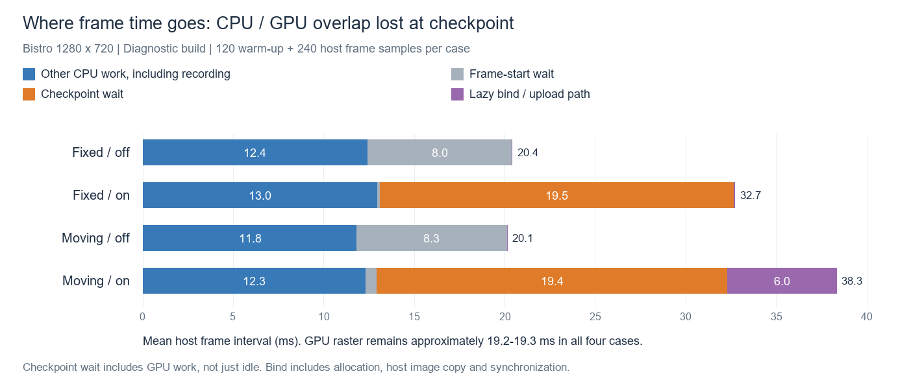

# 当前帧纹理驻留：瓶颈定位

日期：2026-10-26。基于此前的[三轮性能对照](2026-10-26-residency-performance.md)，本次只定位开销来源，不修改驻留策略。

## 结论

主要瓶颈有两项：

1. **每帧中途的同步依赖破坏 CPU/GPU 流水重叠。** 固定近景的 GPU 光栅耗时几乎不变，CPU 需要录制命令后，再阻塞等待本帧 visibility prefix 完成，才能继续处理纹理和录制后半段。这使每帧从约 20.4 ms 增至 32.7 ms。
2. **移动时同步纹理物化/上传造成额外长帧。** 上传所在 bind 阶段平均约 6 ms，最慢样本约 159 ms；它与当帧主机帧时间高度相关。

反馈计算、CPU 位图需求计算和描述符/卸载扫描在本次测试中占比很小。固定视角用于隔离“没有新增上传时仍存在的成本”，不是本次优化目标。

## 方法与采样范围

- 同一 GPU、Bistro、1280×720、固定动画、vbuffer 开启，其余设置沿用此前测试。
- 独立诊断构建加入 3 个 GPU 时间戳边界：feedback begin、feedback end、resume after checkpoint/update。
- CPU 计时覆盖 checkpoint 提交/等待/回收，驻留更新中的 demand/scan/bind/account，以及 graph prefix/suffix 录制。
- 四组各运行 360 帧，丢弃前 120 帧。每组 240 个主机帧样本；帧槽延迟读取使稳态 GPU 数据为 239 个样本，最后两个未读取的 GPU 帧不补造。
- 以下阶段成本使用**均值**；之前三轮报告使用各轮统计的中位数，两者用途不同。
- 先尝试 Nsight Systems，但本机 Vulkan profiler layer 注册需要当前进程没有的注册权限，未获得外部 GPU 时间线。因此本报告基于实际新增的引擎 GPU/CPU 计时点。

## 固定近景：GPU 工作基本不变，等待暴露在关键路径上

| 指标 | 功能关闭 | 功能开启 |
|---|---:|---:|
| 主机平均帧间隔 | 20.407 ms | 32.706 ms |
| FPS | 49.00 | 30.58 |
| GPU visibility raster | 19.349 ms | 19.307 ms |
| GPU feedback 区间 | 约 0（无此 pass） | 0.075 ms |
| GPU resolve（scene） | 0.516 ms | 0.379 ms |
| GPU lighting | 0.152 ms | 0.159 ms |
| CPU 帧首 pace | 7.968 ms | 0.168 ms |
| CPU post 阶段（包含新增中途等待） | 9.800 ms | 29.780 ms |

开启时进一步拆解：

| CPU 阶段 | 均值 |
|---|---:|
| graph prefix 录制 | 9.335 ms |
| checkpoint 提交前准备及提交 | 0.178 ms |
| checkpoint fence wait | 19.544 ms |
| checkpoint 完成后的回收/重新录制准备 | 0.070 ms |
| demand 位图/纹理集合计算 | 0.074 ms |
| descriptor/unload 扫描 | 0.020 ms |
| lazy descriptor bind（无新增上传） | 0.038 ms |
| 整个 residency update（含计时日志调用等） | 0.141 ms |
| graph suffix 录制 | 0.237 ms |

关闭模式仍有帧槽等待，但等待只有约 8 ms：CPU 录制当前帧时可以与之前的 GPU 工作重叠。开启模式在当前帧中部必须取得反馈结果，prefix 录制和该 prefix 的 GPU 执行产生串行依赖。

**不能把 19.544 ms 全部称为同步 API 的额外开销或 GPU 空闲。** 它主要是在等待实际 GPU 工作。帧首等待同时减少约 7.800 ms，因此净暴露的等待约为 `19.544 − 7.800 = 11.744 ms`，接近观察到的整帧增加 `32.706 − 20.407 = 12.299 ms`。现有 GPU 时间戳也显示光栅工作没有相应增长。

图中的 Other CPU 为主机帧间隔扣除几个已测等待/bind 阶段后的余量，包括录制及未单列的 CPU 工作。帧首 pace 来自 60 帧分组均值，数值经过日志舍入，图表用于近似阶段归因。

## 移动镜头：同步上传解释额外波动

| 指标 | 关闭 | 开启 |
|---|---:|---:|
| 主机平均帧间隔 | 20.141 ms | 38.322 ms |
| FPS | 49.65 | 26.09 |
| P99 主机帧间隔 | 23.719 ms | 129.409 ms |
| GPU visibility raster 均值 | 19.150 ms | 19.206 ms |
| GPU feedback 区间均值 | 约 0 | 0.052 ms |
| CPU checkpoint wait 均值 | 不执行 | 19.406 ms |
| CPU demand 均值 | 不执行 | 0.075 ms |
| CPU descriptor/unload scan 均值 | 不执行 | 0.131 ms |
| CPU lazy bind 均值 | 不执行驻留 bind | 6.000 ms |

开启模式中，bind 耗时与逐帧主机间隔的 Pearson 相关系数约 **0.995**。最慢的稳态样本为：

- 帧号 272，主机帧间隔 193.799 ms。
- CPU prefix 录制 8.926 ms，checkpoint wait 21.233 ms。
- lazy bind 158.811 ms，占该帧主机间隔约 82%。
- 新需求源 payload 为 286654384 B，约 273.4 MiB。

bind 并非单纯写入几个描述符：`prepare_lazy_descriptors()` 会 demand 尚未物化的 lazy image，进而执行 `materialize()` → `create_image()`。当前 host image copy 路径为每张图片创建/准备物理资源，在 `vkCopyMemoryToImageEXT` 前后分别提交布局/可见性转换并等待完成。该同步路径位于当前帧 shading 前的关键路径上。

已定位到整条物化/上传路径，但**本轮尚未分别量化内存分配、host image copy、每张图片的转换提交/等待各自的占比**。因此不能将全部 158.811 ms 直接归为 PCIe 传输，也不能把新增需求源字节数当作硬件总线流量。

## GPU 时间戳如何解释

- `residency feedback` 在反馈 dispatch 前后写入时间戳，位于同一个 prefix submission 内，约 0.05～0.08 ms；它包含反馈及相邻依赖边界，足以排除其为此次数十毫秒损失的主因。
- `residency gap` 从反馈结束量到恢复后半段，跨 checkpoint/host update。固定近景均值 0.577 ms，移动均值 6.677 ms、最大 160.254 ms。该区间包含 host 间隙以及物化/上传相关操作，**不是独立 GPU shader 执行耗时**。
- 时间戳不能将 GPU 工作时间与 CPU 等待相加作为额外成本，两者往往在测量同一段等待中的 GPU 工作。
- 本轮没有完整 GPU/CPU 调度时间线；流水重叠减少的判断来自阶段依赖、相同 GPU 光栅成本和主机非重叠阶段计时之间的交叉证据。

## 下一步定位优先级

1. 围绕当前帧反馈必须在 shading 前返回这一依赖，研究怎样恢复跨帧的 CPU/GPU 重叠；这对动态视角同样重要。
2. 对 lazy image 物化路径继续分解 allocation、layout submit/wait、host image copy，确认批量上传与批量同步能减少多少关键路径时间。
3. 再评估不可见纹理的回收时机，量化短期保留纹理所需额外显存与减少重复上传的收益。

本次不实施这些优化。若仍要求当前帧精确需求、当帧纹理完整且不预留额外驻留，部分等待由这些约束决定，需要从架构层面权衡。

## 验证与证据

- [完整阶段统计](2026-10-26-residency-bottleneck/analysis.json)
- [移动逐帧关联数据](2026-10-26-residency-bottleneck/sweep-selective-joined.csv)
- [原始计时、日志、配置及诊断源码快照](2026-10-26-residency-bottleneck/evidence.zip)
- [独立计时补丁](2026-10-26-residency-bottleneck/instrumentation.patch)。采集结束后已撤出主源码中的临时计时逻辑，未实施任何驻留优化；独立诊断二进制与源码快照继续保留供复核。
- 原始数据：`tmp/residency-stage-profile-20261026/`，包括每组配置、帧间隔、GPU 阶段 CSV、CPU 计时日志、截图与构建 manifest。
- 独立诊断构建：`tmp/residency-profile-bin/deren.exe`，SHA-256 `ce58bca9d1934d2fbc30cc0e43e4d6cce0c815fc7516bf7007b1dde14a6cc76a`。
- 四组均正常退出，未检出 GPU timing mark 拒绝、VUID、Validation Error、SYNC-HAZARD、ERROR 或 panic。
- 额外 16 帧短测试实际开启 Khronos validation，正常完成截图，未检出验证错误或时间戳拒绝。
- 原始性能测试的 executable/DLL 已恢复并按 SHA-256 校验；此前的性能测试构建未被替换。
- 最终再次校验此前记录的全部 71 个构建文件哈希一致；证据压缩包 47 个文件通过完整性检查。
- 本轮每种配置只有一次诊断运行，不替代此前三轮对照，也不建立新的图像一致性结论。新增时间戳和 CPU 日志有测量开销；固定近景诊断 FPS（49.00/30.58）与此前中位数（49.25/30.55）接近。
