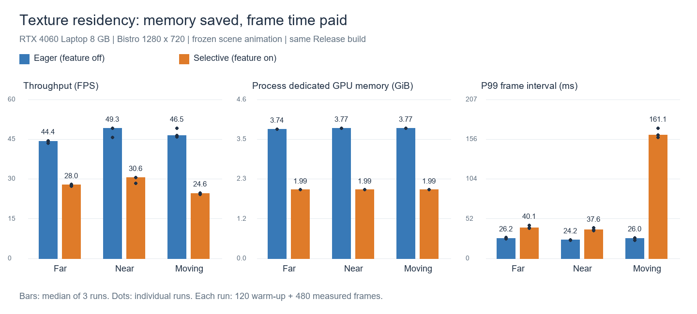
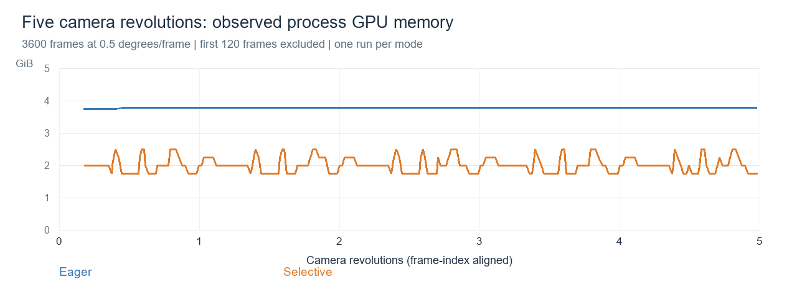

# 当前帧纹理驻留功能：性能测试

日期：2026-10-26。对象为当前工作区的 visibility texture residency 功能，默认关闭。

本轮结果表明，该功能以明显的吞吐下降、移动长帧和 CPU 内存增加换取较低的专用 GPU 内存占用。当前适合继续作为显式开启的显存策略评估，尚不具备默认启用的性能依据。

## 基础对照结果

同一 Release 构建，RTX 4060 Laptop GPU（8 GB，驱动 617.42），Bistro core-MR，1280×720。开启 visibility buffer，关闭 DAG、软件光栅、HZB、阴影、TAA、SSAO、bloom、FXAA、GUI、垂直同步及帧率上限。场景动画固定在 `animation_time = 0.0`。

每个场景开关各执行三轮，交错开关顺序并反转场景顺序。每轮 600 帧，前 120 帧预热，后 480 帧统计。以下均为各轮统计的中位数，不是把所有帧混合计算。

| 场景 | FPS 关闭→开启 | FPS 变化 | P99 帧间隔 关闭→开启 | 进程专用 GPU 内存 关闭→开启 |
|---|---:|---:|---:|---:|
| 固定远景 | 44.44→27.98 | −37.0% | 26.21→40.14 ms | 3.74→1.99 GiB |
| 固定近景 | 49.25→30.55 | −38.0% | 24.16→37.64 ms | 3.77→1.99 GiB |
| 连续旋转（0.5°/帧） | 46.51→24.63 | −47.0% | 25.95→161.14 ms | 3.77→1.99 GiB |

专用 GPU 内存下降约 47%，但 CPU 工作集从约 5.58 GiB 增至 7.09～7.61 GiB。共享 GPU 内存约 31 MiB，未出现同等规模的共享 GPU 内存增加。工作集是进程驻留内存计数，不能等同于全部 CPU 分配量。

移动镜头下，开启模式的 1% low 为 4.84 FPS，关闭为 35.23 FPS；每轮 480 个统计帧中，开启模式分别有 13、13、14 帧超过 100 ms，关闭模式均为 0。开启时各轮最大帧间隔的中位数为 247.44 ms。移动时进程专用 GPU 内存的全进程采样峰值中位数为 2.49 GiB，高于稳定段的 1.99 GiB 中位数。

## 图像一致性

基础矩阵最终截图的 9 对开关比较，6 对 decoded RGB 完全一致，3 对不一致，严格逐像素门禁未通过。

- 第 1 轮近景：14809/921600 个像素变化，其中 120 个像素任一通道差异 >4，最大差异 30/255，平均每通道绝对差异约 0.0085/255。
- 第 1、2 轮旋转终点：各 13393 个像素变化，其中 24 个像素差异 >4，最大差异 9/255。
- 同模式重复比较中，关闭模式的近景及旋转也存在差异。因此当前证据不能将非确定性归因于纹理驻留功能；根因尚未确定。

最初复用现成脚本时未固定场景动画，发现画面不一致后，保留初次矩阵并固定动画重跑。固定动画消除了一个混杂变量，但没有完全消除上述非确定性。初次矩阵不用于上表。

## 压力与正确性补充

| 场景 | 设置 | FPS 关闭→开启 | P99 关闭→开启 | 1% low 关闭→开启 |
|---|---|---:|---:|---:|
| 反复转身 | 180°/帧，360 帧，预热 60 帧，三轮中位数 | 45.64→14.35 | 25.68→106.85 ms | 37.33→8.88 FPS |
| 五圈连续旋转 | 0.5°/帧，3600 帧，预热 120 帧，单轮 | 49.35→25.51 | 24.02→138.88 ms | 39.37→5.45 FPS |

反复转身的 FPS 下降约 69%，开启组每次运行日志累计新增上传约 52.06 GiB。五圈连续旋转开启组累计新增上传约 59.96 GiB，1986 次有新增上传的 update。累计上传包括预热及额外截图帧，不代表同时驻留内存，也不是独立 PCIe 硬件流量计数。

长循环开启组的五个单圈，专用 GPU 内存中位数均为 1.99 GiB，采样峰值均为 2.49 GiB。CPU 工作集的单圈中位数约为 7.77、7.76、7.76、7.63、7.63 GiB；未出现逐圈单调增长。关闭组专用 GPU 内存约 3.77 GiB、CPU 工作集约 5.58 GiB。开启组稳定段 3480 帧中有 81 帧超过 100 ms，关闭组为 0。观测窗口约 136 秒稳定段，单次重复五圈，不能证明长时无泄漏。

首次转身和返回采用额外的短帧数截图，配置固定动画、180°/帧，分别在 `--capture-frames 1` 和 `2` 下比较开关。截图请求在下一帧消费，因此覆盖第一次反向视野和随后的返回视野；这些运行开启 Khronos validation，独立于性能计时。

首次转身及返回的两对 decoded RGB 均完全一致。四次运行日志均确认 Khronos validation 实际启用，进程正常退出，未检出 VUID、Validation Error、SYNC-HAZARD 或 ERROR 诊断。

全部 15 对截图中，11 对完全一致、4 对不一致；整体严格图像门禁未通过。补充的不一致发生在第 3 轮反复转身终点（15537 个变化像素，最大通道差异 13/255）。五圈长循环的最终图像完全一致。不能用这些终点截图推断所有中间帧均无问题。

## 对开销来源的判断

固定镜头下，在没有持续新增上传的情况下，开启模式仍有约 37%～38% 的 FPS 下降，说明仅优化首次加载不能解决全部开销。实现每帧在 visibility prefix 后提交并等待 checkpoint，然后读取反馈、更新描述符及驻留，再录制后半段。

移动和反复转身时，日志确认了大量重复上传，进一步增加长帧。上述实现机制与观测吻合，但本轮未给 checkpoint wait、反馈计算、描述符处理及上传各自打独立计时点，因此不能给出各项成本的精确占比。下一步性能定位应优先拆分这些阶段，并量化保留近期纹理的策略需要多少额外显存；本轮没有修改策略。

## 测量口径与限制

- FPS 为统计帧数除以这些帧的主机侧帧间隔总和。边界位于成功 `submit_and_present()` 返回后，属于主机观测的提交/呈现循环吞吐；不是显示器实际扫描时间，也不是独立 GPU pass 耗时。
- 本轮不使用跨 host wait 的 GPU timestamp 区间推导纯 GPU 渲染成本。现有日志的 residency update 时间不包含 checkpoint wait；尚未精确拆分各项开销。
- 首帧指渲染循环中的第一帧，包含首次执行中的工作，不包括循环前的全部场景初始化，也没有清除磁盘/驱动缓存。不能将其称为严格冷启动时间。
- 显存指标来自按 PID 筛选的 WDDM GPUProcessMemory 计数；独立于纹理源 payload 字节数。约 0.5～1 秒采样，采样峰值可能漏掉短峰值，不能证明驱动将全部差值物理归还给系统。
- 相机按帧索引移动，确保两组测试相同视角序列；两组每秒转动速度不同，不能将其称为相同角速度下的用户操作测试。
- 最终截图只覆盖终点。短帧数验证截图补充特定首次显露帧，仍不构成全程每帧的正确性证明。
- 单一 GPU、单一资产、单一分辨率，不能外推其他硬件、复杂画质组合或实际显存溢出场景。

## 证据与复现

- [汇总数据](2026-10-26-residency-performance/summary.json)
- [测量复核与图像差异](2026-10-26-residency-performance/audit.json)
- [逐帧时间、内存采样与配置压缩包](2026-10-26-residency-performance/measurement-traces.zip)
- 基础原始数据：`tmp/residency-review-pinned-20261026/`，含 manifest、每轮配置、日志、frames.csv、memory.jsonl、截图、summary.json、audit.json 与构建文件哈希。
- 首次未固定动画的排查数据：`tmp/residency-review-20261026/`。
- 压力原始数据：`tmp/residency-review-pinned-stress-20261026/`。
- [执行脚本快照](2026-10-26-residency-performance/tools/run_pinned_baseline.py)、[压力脚本快照](2026-10-26-residency-performance/tools/run_stress.py)、[复核脚本快照](2026-10-26-residency-performance/tools/audit.py)。调用现有 `scripts/measure/measure_texture_residency_detailed.py` 的采样实现，仅在配置生成后补入 `animation_time = 0.0`。实际调用位于 `tmp/residency-review-tools/`。
- 测试二进制 SHA-256：`5d39aa5b6a617a9f164f6125bb29c257b93419b8af1e270f4b1d36cf84edfdce`。基于 `6de686cd` 加当前工作区的未提交 feature，不能仅按该提交重现。

全部原始结果保留在本机。没有为本轮性能测试修改引擎或 shader。
