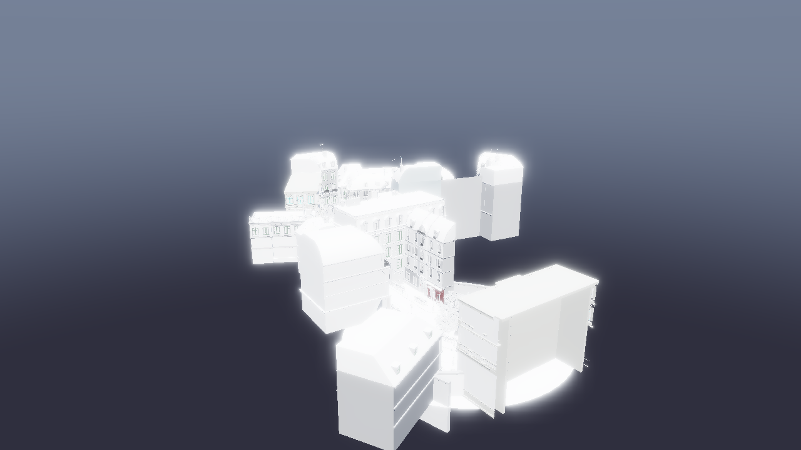

# Bistro 大场景：新特性实际增益实测（2026-10-20）

对 4,208,625 三角形 / 2,909 个绘制对象 / 6,006 节点的 Bistro 静态场景，实测两项新特性的真实收益：

| 特性 | 实际增益（本机实测） | 代价 |
| --- | --- | --- |
| **item 容量 1024→4096**（启用 visibility lane） | 同一远距相机 GPU 帧时间 **178.5 ms → 26.7 ms（约 6.6×）**；scene pass 177.8 ms → 0.3 ms | 需要 meshlet 容量从 14-bit 降到 12-bit（每 item ≤4096 meshlet），本项目最大 item 1395，无回退 |
| **Subtilis LOD**（在 4096 容量之上） | 三角形 **−11.4%（far）/ −12.4%（near）**；GPU 帧时间 **−8.7%（far，−2.35 ms）/ −8.7%（near，−2.08 ms）**；端到端墙钟帧时间 **−8.2% / −8.1%** | CPU host 选层 **+8.6 ms/帧**（2,909 items，≈3 µs/item）；当前 GPU-bound（GPU 22–25 ms，CPU active ~15 ms）仍有余量吸收，尚未抵消净收益 |

结论：**容量扩展不是"小优化"而是把该场景从不可用路径拉到可用路径（~6.6×）；Subtilis 在其上再给约 8–9% 的 GPU/帧时间收益，CPU 侧代价 8.6 ms 目前被 GPU 空档吸收。** 一旦 GPU 帧时间降到 ~15 ms 以下或 item 数继续增加，host 选层会成为新瓶颈（后续 GPU 选层 M2 要解决的就是它）。

## 测试方法与配置

- **资产**：`D:/deren-assets/bistro/bistro-geometry.gltf`（原始未合并层级；6006 nodes / 254 materials / 2,909 primitives / 4.2M 绘制三角形 / 0 textures）。选无纹理版本是为了排除纹理内存与采样对测量矩阵的干扰；三角形侧开销与纹理场景一致。
- **临时验收补丁**（仅实验用，已还原）：`DEREN_BISTRO_BUILD=1` 时在 `create_primitive` 里为每个 64B stride 的 draw 构建 Subtilis 层级，**OFF 和 ON 都构建同一份资产**，两组只差"lane 是否消费层级"。2909 个层级全部构建成功、0 失败、峰值进程内存 0.95 GB、加载多约 10–15 s。补丁归档为 [acceptance-probe.patch](acceptance-probe.patch)，测量后已 `git checkout` 还原并重新编译；工作区没有残留。
- **两组矩阵**：
  1. **GPU 交叉验证矩阵**：validation 开，130 帧/次，OFF/ON 各 3 次交错（far + near）。
  2. **墙钟 + CPU 矩阵**：validation 关，130 帧/次 + 3 帧 load 基线，OFF/ON 各 2 次交错（far + near）。
- **指标来源**：引擎自带的 `gpu pass timings (session avg of N frames)`（GPU timestamp）、同一日志的最后一帧窗口 `avg of N frames over X s`（端到端墙钟帧时间）、`cpu frame phases`（steady-state 窗口）以及补丁里 `record_visibility_items` / subtilis cut 的微秒级计时。
- **机器**：RTX 4060 Laptop，NVIDIA 617.42，Release，1280×720，vsync off，`max_fps=0`，shadow/TAA/FXAA/SSAO/bloom 全关，deferred lit 路径。单机单会话、未锁频，**不构成发布基准**。

## Subtilis OFF/ON 结果

| 指标 | far OFF | far ON | 变化 | near OFF | near ON | 变化 |
| --- | ---: | ---: | ---: | ---: | ---: | ---: |
| GPU visibility raster（中位，ms） | 26.22 | 23.89 | **−8.9%** | 23.00 | 20.95 | **−8.9%** |
| GPU 帧总时间（中位，ms） | 26.98 | 24.63 | **−8.7%（−2.35 ms）** | 24.03 | 21.95 | **−8.7%（−2.08 ms）** |
| 端到端墙钟帧时间（ms） | 25.25 | 23.18 | **−8.2%** | 22.67 | 20.83 | **−8.1%** |
| 输入 → 选中三角形 | 4,208,625 → 3,727,209 | | **−11.4%** | 3,626,626 → 3,175,714 | | **−12.4%** |
| 输入 → 选中 meshlet records | 50,808 → 45,493 | | −10.5% | 43,930 → 38,864 | | −11.5% |
| coarse records / fallback items | 9,451 / 0 | | | 7,342 / 0 | | |
| 可见 item | 2,906 / 4,096 | | | 2,840 / 4,096 | | |
| CPU 选层代价（ms/帧） | ~0.08（无选层） | 8.68 | **+8.6** | ~0.07 | 8.69 | **+8.6** |
| CPU active（ms/帧，steady） | 6.65 | 15.26 | +8.6 | 6.05 | 15.45 | +9.4 |

validation 开启的 3×3 交叉矩阵给出一致结果（far −8.3%、near −9.3% 的 GPU 帧时间），说明矩阵不是单次噪声。GPU 帧时间减少 8.7% 而三角形减少 11–12%——dispatch/raster 的固定开销占了差额。

**画面差异（OFF vs ON，同相机）**：

| 相机 | 变化像素 | 每像素 RGB 最大通道差均值（8bit） | >4 像素占比 | 最大差 |
| --- | ---: | ---: | ---: | ---: |
| far | 0.938% | 0.0200 | 0.056% | 84 |
| near | 0.098% | 0.0017 | 0.004% | 64 |

变化集中在 LOD 切换的边缘/细部，**不能宣称像素级一致**；与上一轮 merged 资产（254 items）的 0.25%/0.009% 相比，原始 2909 items 的 far 变化更大（0.94%）。

## 容量扩展本身：1024 → 4096 的解锁效果

同一资产、同一 far 相机，旧构建（item 容量 1024）触发整帧回退：`visibility raster 0.01 ms`、`scene 177.8 ms`（2909 次 legacy 完整 draw），GPU 帧总时间 **178.5 ms**；新构建（容量 4096）走 meshlet visibility lane：`visibility raster 26.2 ms`、`scene 0.28–0.46 ms`，GPU 帧总时间 **26.7–27.0 ms**。即 **约 6.6×（178.5 ÷ 27.0）**；ON 侧旧回退 168.4 ms → 24.6 ms，约 6.8×。

- 旧基线来自 `docs/reviews/2026-10-20-bistro/` 里 1024 容量构建的未合并场景日志（16 帧 capture、`gbuffer_debug=on`、同 far 相机）；新数字来自本轮 4096 构建（lit、130 帧）。两者渲染数学没有差异，差异项已如实标注。
- 这不是"Subtilis 的收益"，而是**容量契约把场景从 legacy 整帧回退切到 visibility lane 的收益**；没有它，Subtilis 在该场景上根本无法生效。

## 三个探针：优化空间的实测定位（追加）

为了决定下一步该做 GPU 选层、HZB 遮挡还是软件光栅，先用两个**只读**探针 + 离线分析把三个数測出来（不改生产行为）：

- **cluster dump**（临时探针 `DEREN_CLUSTER_PROBE_DUMP`，已移除）：相机 view/proj、窗口、每个可见 item 的 model 矩阵 + 其每个 meshlet 的对象空间包围球和三角形数。用 2 帧 OFF capture，即"全量 dispatch 候选集"。
- **depth dump**（引擎**已有**的 `DEREN_DEPTH_PROBE_CAPTURE`）：截图帧的原始 D32 深度。
- 离线分析：`scripts/measure/cluster_occlusion_probe.py`——与 mesh stage 同款的保守球视锥测试、max-depth pyramid 的**保守** HZB 遮挡测试（结果只是下界）、cluster 投影直径分档。

| 指标（保守下界） | far（d=140 全景） | near（d=42 街道） |
| --- | ---: | ---: |
| meshlet 视锥剔除率 | 0.0% | 1.9% |
| 视锥内可见 meshlet 被**完全遮挡** | 0.41% | **33.28%** |
| 遮挡三角形占可见三角形 | 0.33% | **32.52%** |
| cluster 投影直径 <1px | **22.05%**（三角形 21.13%） | 3.09%（2.72%） |
| cluster 投影直径 <2px | 38.57%（37.60%） | 13.36%（12.43%） |
| 校验：投影中心落在已渲染几何上 | 99.74% | 99.35% |
| 校验：深度前景覆盖 | 17.36%（与截图前景一致） | 93.34% |

**这三个数直接改了优先级判断**（都是保守值，真实值只会更大）：

- **视锥剔除已经没有油水**（0–2%）：之前设想的"compute 预剔除省 launch"，在网格阶段已经自剔之后只剩遮挡级收益。
- **遮挡剔除是相机相关的**：近景/街道视角 **约 33% 的三角形被完全遮挡**，是最大单项 GPU 机会；远景全景只有 0.4%，HZB 对远景几乎无收益。
- **亚像素 cluster 正好相反**：远景 **22% cluster / 21% 三角形 <1px**（Nanite 式软件光栅的触发条件），近景只有 3%。
- 结论：**M3（HZB 两遍遮挡）主攻近景/大场景内部，M4（软件光栅）主攻远景**，两者互补；应先按目标相机分布选一个做，而不是同时铺开。

## CPU 选层并行化（已实现并实测）

上一节数据说明 GPU 侧还有大改的空间，但 CPU 侧的 8.6 ms/帧也得先处理掉（它现在被 GPU 空档掩盖，一旦 GPU 变快就会暴露）。`record_visibility_items` 已重构为四阶段：

1. **串行候选扫描**（保持旧规则：任一候选不能承载就整帧拒绝；buffer 地址查询不做并行）；
2. **并行逐 item 规划**：进程级 2–8 线程池、每个 worker 独立 scratch，唯一的共享写是 item **自己**的 `meshlet_base` 区段（`meshlet-culled` 表），互不重叠；`published` 在这一阶段为空；
3. **发布规则按 item 顺序裁决**：旧实现的 `published` 是 O(n²) 线性扫描；现在用有序区间表，每 item 一次二分查找。**任一 item 若与更早发布的 run 重叠，就在这一步按序重规划**（回退 shared），与旧语义逐字节一致——`test_subtilis_frame` 里故意构造的共享 `meshlet_base` alias 用例仍然通过；
4. **串行记录**（命令缓冲、push 数据、item 表本来就必须是录制线程的）。

实测（130 帧/次，validation 关，与并行前同一套 harness）：

| 指标 | 并行前（串行） | 并行后 |
| --- | ---: | ---: |
| CPU `post` 阶段（含 `record_visibility_items`），far ON | 13.93 ms | **6.28 / 7.48 ms** |
| 同上，near ON | 14.57 ms | **6.28 ms** |
| 同上，far OFF（对照） | 6.07 ms | 4.16 ms |
| 选层 CPU 成本（估算） | ~8.6 ms/帧 | **~2 ms/帧** |
| cut 结果 | 4,208,625→3,727,209 tris（−11.44%） | **完全相同** |
| 画面 | — | **与串行版逐像素相同**（far/near/off 三组） |
| 测试 | — | CTest 57/57、ASan/UBSan 6/6 |

GPU 工作没有变化，因此当前 GPU-bound 下墙钟帧时间不变（省下的 CPU 变成了 `pace` 等待），但这项改动换来的是：**CPU 侧余量**（为更多 item / 更快 GPU / M2 之前过渡），以及移除了旧路径上 2909 items 规模的 O(n²) 扫描。同会话里 GPU OFF→ON 的增量这次是 −1.06 ms（far）/−1.31 ms（near），与本机跨会话 ±2 ms 的频率漂移同量级，因此 GPU 的相对收益仍按首个矩阵的 −8% 范围引用。

> 一致性证据的边界：cuts 与"截图逐像素相同"是在并行版本首次实现时验证的；之后只为 **alias 重叠语义**补了"重叠 item 串行重规划"路径（`test_subtilis_frame` 的共享 `meshlet_base` 用例覆盖，CTest 57/57 通过）。正常场景（各 item 空间互不重叠）走的并行路径没有变化。

## 调参实验（负结果，已归档）

在动手做 HZB / 软件光栅之前，先用**临时环境变量钩子**验证了两个"改个数字就能拿性能"的假设（钩子已全部移除，生产代码只有并行化改动）：

**1) 运行时 cut 的屏幕误差预算**（`view_parameters.target_error_px`，默认 1 px）

| error budget | far records | far GPU visibility | near records | near GPU visibility |
| --- | ---: | ---: | ---: | ---: |
| 1 px（默认） | 45,493 | 27.42 ms | 38,864 | 24.12 ms |
| 2 px | 45,093（−0.9%） | 27.96 ms | 38,532（−0.9%） | 24.89 ms |
| 3 px | 44,979（−1.1%） | 27.98 ms | 38,312（−1.4%） | 23.93 ms |
| 4 px | 44,920（−1.3%） | 27.70 ms | 38,176（−1.8%） | 23.78 ms |

1→4 px 只让选中记录数降 ~1%，GPU 时间在会话噪声内不动；画面差异却已经到 far 1.2–1.7% 像素、near 0.3–1.6%。**结论：cut 不是被误差预算卡住的，运行时质量/性能旋钮不值得接线。**

**2) 层级构建参数**（`build_options.target_ratio` / `max_error`，默认 0.5 / 0.01）

| 变体 | far records | far GPU visibility | 相对默认画面差异 |
| --- | ---: | ---: | ---: |
| 默认（0.5 / 0.01） | 45,493 | 27.42 ms | — |
| target_ratio 0.35 | 45,638（反而 +0.3%） | 27.90 ms | 0.27% 像素 |
| max_error 0.03 | 45,002（−1.1%） | 27.73 ms | 0.26% 像素 |
| ratio 0.35 + error 0.03 | 45,042（−1.0%） | 26.98 ms | 0.43% 像素 |

同样只动 ~1% records、GPU 噪声内。**结论：层级参数也没有留下可测的余量。**

两个负结果合起来说明：当前 cut 的收益已接近这个层级结构的边界，**剩余收益只能来自结构性 GPU 侧**——近景遮挡（33% 可见三角形，保守下界 → HZB 两遍）或远景亚像素（22% cluster <1px → 软件光栅），参数调优无法触及。

## M3 原型验证：host 侧 Hi-Z 遮挡剔除（已回退，仅保留测量）

为了验证"近景 33% 遮挡"能否换成实际 GPU 时间，先做了一个**host 侧两段式原型**（环境变量门控、静态相机、已回退，补丁归档为 [occlusion-prototype.patch](occlusion-prototype.patch)）：每帧把 G-buffer 深度拷到 frame-slot 的 host 可读 buffer；下一次用同一 slot 时 CPU 建 max-depth Hi-Z 金字塔；在并行规划阶段把 cut 选出的 meshlet 包围球逐个测试，被完全遮挡的记录压紧回 host-culled 表并缩小 dispatch 的组数。

| 指标（130 帧，validation 关） | far OFF | far ON | near OFF | near ON |
| --- | ---: | ---: | ---: | ---: |
| 被剔除的选中记录 | — | 0 / 2.73M（0%） | — | **1.67M / 4.66M（35%）** |
| GPU visibility raster | 23.85 ms | 23.77 ms | 20.79 ms | **14.16 ms（−31.9%）** |
| GPU 帧总时间 | 24.60 ms | 24.90 ms | 21.77 ms | **15.61 ms（−28.3%）** |
| CPU active | 7.68 ms | 19.97 ms（+12.3） | 7.73 ms | 18.95 ms（+11.2） |
| 端到端帧时间 | 23.18 ms | 23.49 ms | 20.61 ms | **18.70 ms（−9.3%）** |
| 画面差异 vs OFF | — | **逐像素相同** | — | 0.314% 像素变化（mean 0.003/255，max 10） |

**这组数把 M3 的工程决策钉死了：**

1. **遮挡红利是真的，而且确实转化为 GPU 时间**：near 剔掉 35% 的记录 → visibility raster −32%、GPU 帧 −28%；far 为 0（与探针的 0.4% 一致）。
2. **host 实现吃掉大部分收益**：CPU 每帧多 11.2 ms（金字塔构建 + 4.6 万次球测试），near 帧变成 CPU-bound（CPU active 18.95 ms vs GPU 15.61 ms），端到端只剩 −9.3%，而不是 GPU 侧给出的 −28%。
3. **还不像素精确**：near 有 0.314% 像素变化（近平面深度近似不够保守），所以 host 版本不能发布；far 逐像素相同。
4. **结论**：遮挡剔除值得做，但**必须在 GPU 侧做**——HZB 构建 + 保守球测试放进 compute（剔除后再 dispatch，必要时两遍 + recovery），才能保住 −28% 的 GPU 收益同时消掉 11 ms 的 host 成本。这就是下一步 M3 的形状。

## 怎么解读这些数字

- 两项特性的收益来源不同：**容量 = 换路径**（2909 个完整 draw → 2909 个间接 mesh dispatch + meshlet 剔选，scene pass 几乎归零）；**Subtilis = 在 lane 内换层级**（减 11–12% 三角形，换 8.7% GPU 时间）。
- **优化顺序现在由探针数据决定**，而不是由"直觉上 Nanite 该有什么"：
  - 视锥剔除没有空间（0–2%），不用为此加 compute pass；
  - **近景遮挡 33%**（保守下界）→ HZB 两遍遮挡（M3）优先，且收益集中在室内/街道视角；
  - **远景 22% cluster 亚像素** → 软件光栅（M4）优先，且收益集中在远景；两项互补，可按目标相机分布二选一先做；
  - GPU 两级剔除（M2）的价值也主要来自"把遮挡测试搬到 dispatch 之前"，单独做视锥剔除价值很低。
- CPU 选层已并行化：8.6 ms → ~2 ms，cuts 与串行版逐字节一致、截图逐像素相同。它当前不改变墙钟帧时间（GPU-bound），但为 M2 的过渡、更多 item 和更快 GPU 留了余量；旧路径的 O(n²) `published` 扫描也已移除。
- 本轮是单机单会话测量，未做多轮交错长稳与频率锁定；GPU 绝度时间跨会话漂移 ±2–4 ms 量级，所以 GPU 相对收益按同会话 OFF/ON 对计算。未测：120 Hz 以上、其他资产、移动 GPU、纹理场景的端到端 FPS。

## 证据文件

- [results.json](results.json)：全部结构化结果（容量解锁、OFF/ON 汇总、图像质量、**探针结果、并行化结果**、每轮日志明细）。
- `perf-results.json`：三轮 GPU 交叉矩阵与墙钟矩阵的**逐轮原始解析**（含每轮的 GPU/CPU 窗口、cut 统计），用于复核汇总值。
- `*.log.gz`：GPU 交叉矩阵、墙钟/CPU 矩阵、探针采集与并行化运行的完整原始日志。
- `probe-analysis-far.json` / `probe-analysis-near.json` + `probe-clusters-*.bin.gz` + `probe-depth-*.bin.gz` + `cluster_occlusion_probe.py`：三个探针的原始 dump 与离线分析（可重跑复核）。
- `parallelization-results.json` / `parallelization-wall-times.json` / `par2-*.log.gz`：CPU 选层并行化的结果。
- `perf2-wall-times.json`：墙钟测量矩阵每次运行的起止秒数。
- `*.webp`：far/near 的 OFF/ON 无损截图。
- `*.toml`：实际使用的 4 个配置（validation 开/关 × OFF/ON）。
- [acceptance-probe.patch](acceptance-probe.patch)：临时 builder 补丁原文（已还原，未留在生产代码）。
