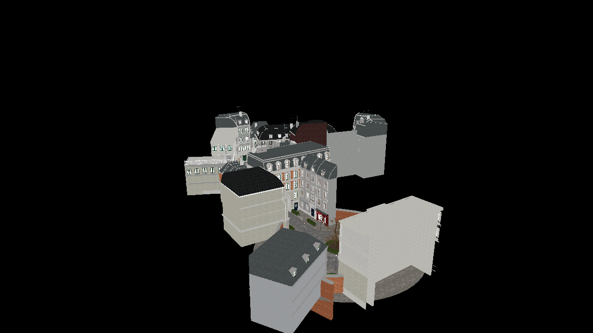
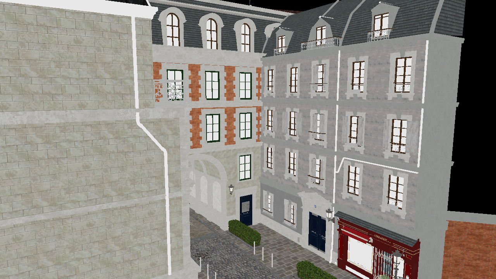
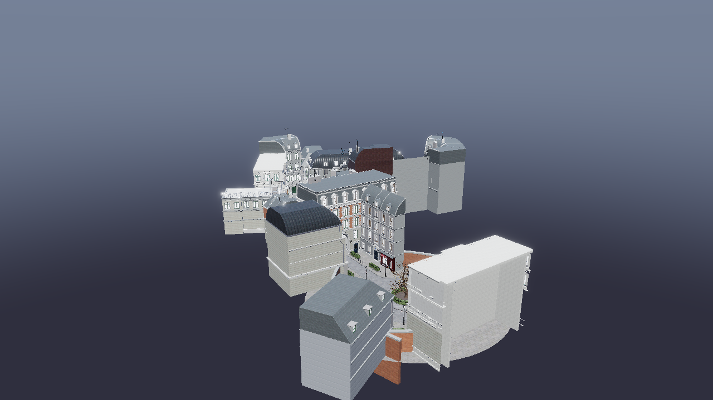
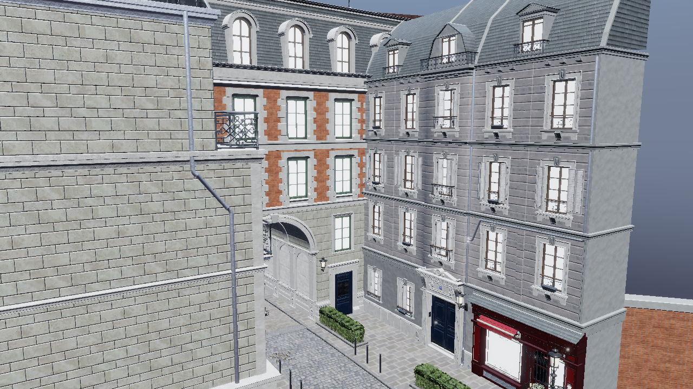
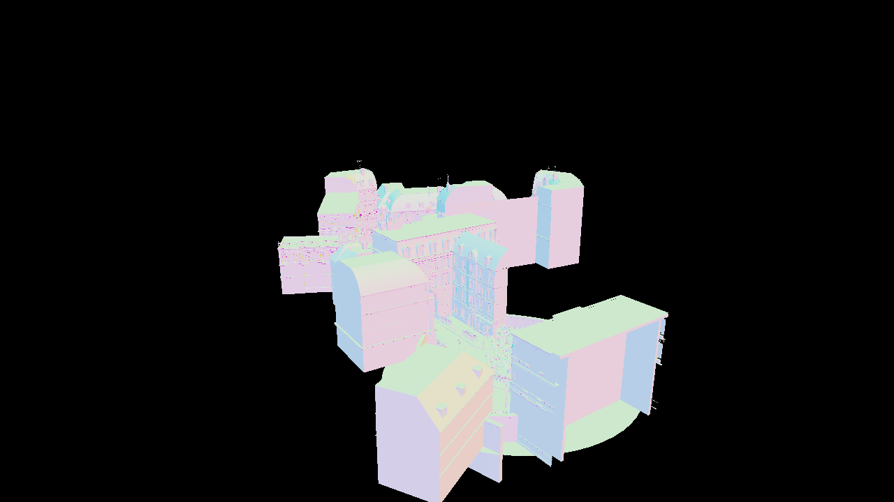
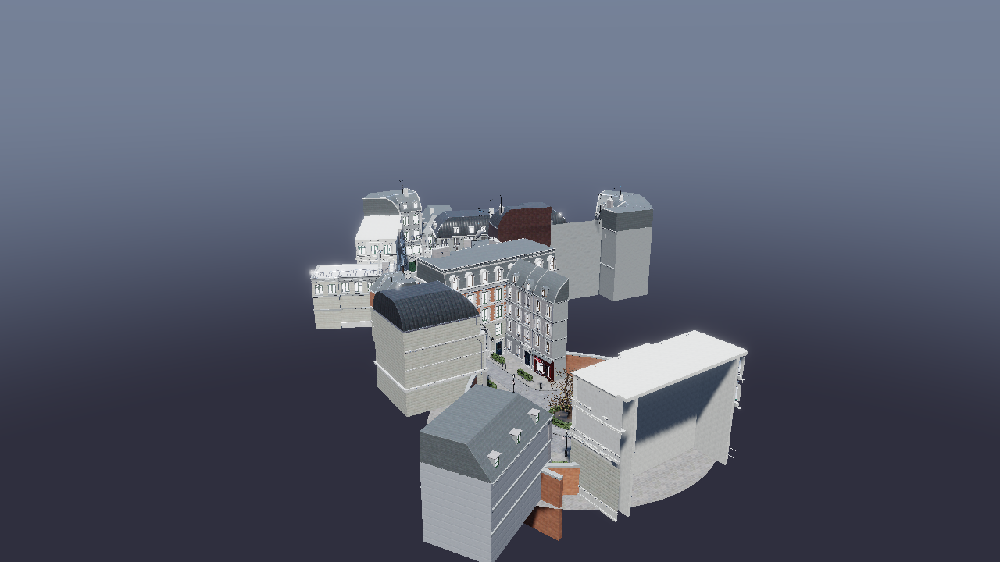
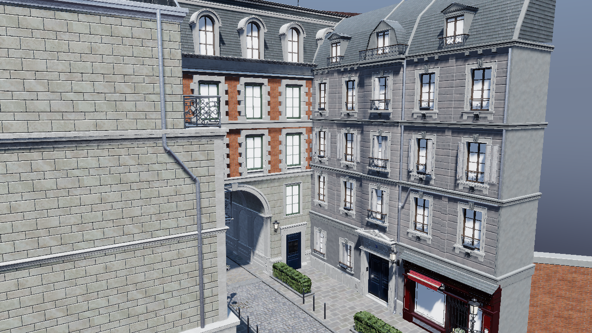
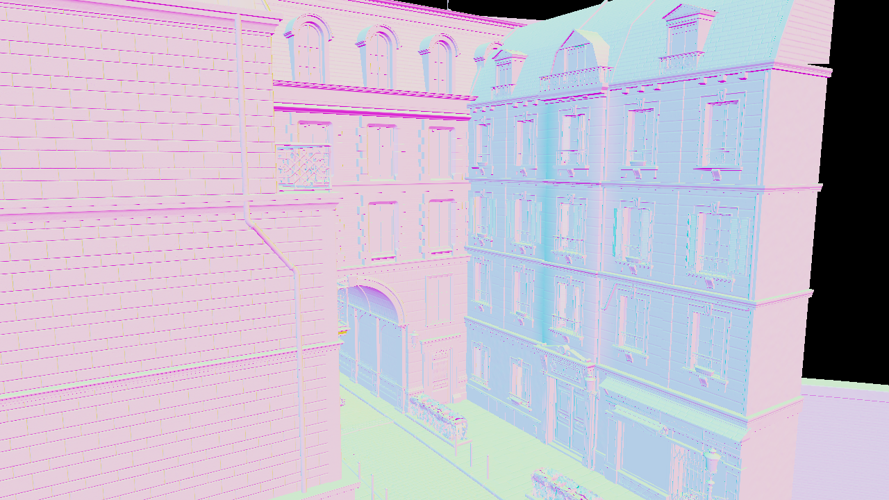
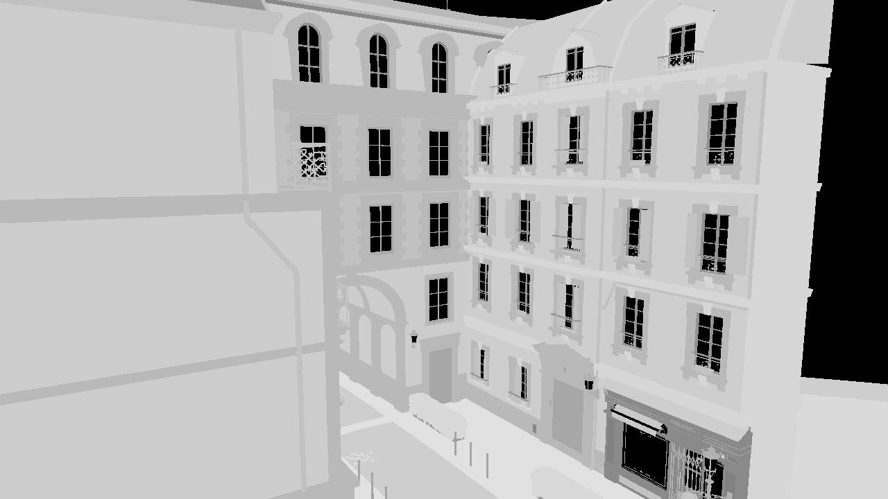
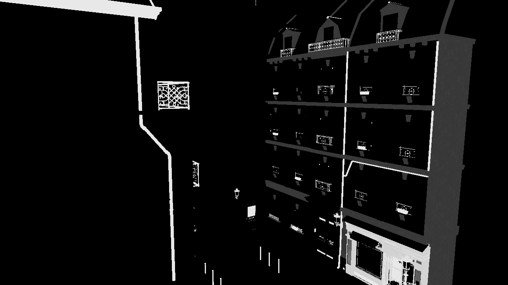

# Bistro：纹理资产 + 4096 容量真机验收（2026-10-20）

完成两项**容量契约的真实 GPU 验收**并且都有 RED→GREEN 证据：①可见性打包 ID 的 item 容量 4096（原始未合并层级 2909 个绘制对象，2906 项实际入表，无回退）；②场景纹理数组容量 1024（网格扩到 2048 槽；textured Bistro 实测只需 516 个运行时纹理槽，全部写入、无白染降级、validation 干净）。带纹理资产的 albedo 与 lit 视图在远/近两个固定相机下都已出图；**PBR 路径另行验收**（开阴影的 lit 渲染 + G-buffer 的 normal/roughness/metallic/AO 通道），normal 与 roughness/metallic 贴图确认被 PBR 着色消费。**纹理场景的 Subtilis OFF/ON 对照仍未做**（需要临时 builder 补丁，本轮未应用任何临时生产补丁），且本轮所有改动未提交、未 push。

## 资产、许可与处理

Amazon Lumberyard Bistro，Amazon Lumberyard / NVIDIA ORCA，2017，原始资产 [CC BY 4.0](https://developer.nvidia.com/orca/amazon-lumberyard-bistro)。上游使用 [zeux/niagara_bistro](https://github.com/zeux/niagara_bistro) 的 glTF 编辑版：tree `2bdb6a410f8ebd475d3737e7c8e038ed2b00b02e`，`bistro.gltf` blob `83bc8307a00dd54b0fa2fdb10cc890b2955c8b0e`，`bistro.bin` blob `f6c918e6e5fa9b0f0dc3b51d6b6be286783fb8c9`，`bistro-anim.bin` blob `cd635e750025c93e46f425f860a8fc4b69fb9cd3`。原始大资产与 LICENSE 保留在 `D:/deren-assets/bistro`，**不提交到仓库**。

本轮把纹理从「不可读的 DDS」变成可导入的 core glTF，处理链全部由仓库脚本完成（输出在 `D:/deren-assets/bistro/textured-verified`）：

1. `scripts/measure/prepare_bistro_textures.py`：解码 343 张被引用 DDS 为 RGBA PNG（最长边 1024，保留 alpha），**保留 6006 nodes / 551 meshes / 254 materials 的原始层级，不做节点或材质合并**；两个 bin 复制为隔离的 `source-buffer-0.bin` / `source-buffer-1.bin`。
2. `scripts/measure/convert_bistro_metalrough.py`：把 234 个 `KHR_materials_pbrSpecularGlossiness` 材质按 Khronos 参考公式近似转换为 core `pbrMetallicRoughness`（每材质新增 albedo + 打包 MR 两张 PNG）。**这不是 glTF-Transform 的输出**：4.5.1/4.2.1 都依赖 `KHR_materials_specular/ior`，本引擎不支持，所以不能声称与它等价。
3. `scripts/measure/verify_bistro_textured.py`：只读校验（见下）全部 PASS。

| 校验项 | 结果 |
| --- | --- |
| 层级 | nodes 6006 / meshes 551 / materials 254，与上游一致，未合并 |
| 几何 | 每 mesh 索引数与上游逐个相等；三角形记录 1,753,630（实例化后绘制 4,209,006）不变 |
| 缓冲 | 两个 bin 为本地文件名（无 `../`），**与上游 bin 逐字节一致**（SHA-256 相等） |
| 材质 | 无 spec/gloss 残留；`extensionsUsed` 仅 `KHR_materials_transmission` + `KHR_lights_punctual`；234 个转换材质 |
| 纹理 | 811 条 glTF texture 记录（343 源纹理 + 234×2 新纹理，含未使用记录）；**597 张被材质引用的不同图片全部存在** |
| 运行时槽 | 内容+格式去重后 **516 个不同纹理槽**（已在真机日志中验证写入 516，见下） |

> **旧 `D:/deren-assets/bistro/textured/` 是不可信测试产物**：上一轮 glTFTransform 按 `../bistro.bin` URI 覆写了原始 bin，导致读取垃圾数据（旧 4096 截图全黑，mean=0）。本轮已从 pin 住的上游恢复 bin 并复核 blob，**验收只用 `textured-verified/`**。

不支持/未验证项明确列在 `asset-manifest.json`：18 个 transmission 材质不在验收范围；normal map 按解码结果上传，朝向未与参考图比对；spec/gloss 转换是近似。

## 容量契约变更

### A. 可见性打包 ID：item 4096 / 每 item meshlet 4096（上一轮完成，本轮验收）

R32_UINT 布局 `valid 1 / item 12 / meshlet 12 / triangle 7`；item 容量 1024→4096，单 item meshlet 16384→4096，超出单 item 上限仍按既有整帧 admission 回退；共享 meshlet 表 65536 容量不变。RED：新 4096/12-bit 静态断言在旧的 1024/14-bit 实现上 4 处编译失败；GREEN：目标 4/4、Release 57/57。

本轮真机证据（原始层级、无纹理几何）：`bistro-geometry.gltf` 加载 **6006 nodes / 2909 primitives**，`visibility raster: recorded **2906 item(s)**`，小于 4096；无 item/meshlet 溢出日志，validation 0。此前整帧回退是 1024 上限所致，本轮不再触发。

### B. 场景纹理数组：128 → 1024，网格 1024 → 2048 槽（本轮完成）

旧状态：运行时硬上限 `scene_texture_capacity = 128`（`runtime.declarations.cppm` 与 `core.declarations.cppm` 两处镜像字面量），而堆槽网格的纹理区只有 512 槽（`materials = base+512`）。textured Bistro 实测需要 **516 个运行时槽 + 1 个白色 fallback**，同时超过两个旧上限——低于需求的容量不会报错，只会把多余纹理静默降级成白色。

变更（单一推导 → 不再有两处镜像数字）：

- `scene_texture_capacity = 1024` 定义在 `source/engine/render_layout/render_layout.cppm`，**由网格推导**：`heap_slots::materials - heap_slots::textures`，并有 `static_assert` 锁定该等式；`core::scene_texture_capacity` 与 `runtime_detail::scene_texture_capacity` 都改为 alias 同一推导。
- 纹理区为槽 0..1023，materials 起点 512→1024；纹理区之后的**所有**槽统一 +512（相对距离与 per-image stride 不变），网格 `heap_slot_count` 1024→2048，最高使用槽 base+1307，余 740 槽。
- descriptor heap 布局日志实测：`2048 slots x 64 B; textures 0 materials 1024 tlas 1215 ...`，texture array @1179648、material table @1212416，均在 1280 KiB 资源堆内。
- 契约测试 `test_render_resources` 新增：宿主网格纹理区、shader 网格纹理区、`render_layout::scene_texture_capacity` 三者相等；并 `static_assert(capacity >= 517)` 作为**编译期 RED 牙**（旧 128 或 512 下该测试无法编译）。
- `clang-tidy` 之前遗留的 3 处 `readability-trailing-comma` 与 1 处 `readability-redundant-inline-specifier` 一并修掉，capacity 三个模块现在 tidy 干净。

## 真机证据

RTX 4060 Laptop，NVIDIA 617.42，Release，1280×720，离屏 32 帧（日志统计 31 帧），validation 开启，TAA/FXAA/shadow/SSAO/bloom 关闭。每组独立启动。

| 运行 | 资产/相机 | 场景 | 可见项 | 纹理描述符 | 校验 | GPU 总时长 |
| --- | --- | --- | ---: | ---: | ---: | ---: |
| 容量帧 | bistro-geometry，远 `35,18,140,0,-83.071,0` | 6006 nodes / 2909 primitives / 0 textures | 2906 / 4096 | 0 | 0 | 29.28 ms |
| 纹理 albedo 远 | textured-verified，远相机 | 6006 nodes / 2909 primitives / 811 textures | 2906 / 4096 | **516** / 1024 | 0 | 26.34 ms |
| 纹理 lit 远 | 同上 | 同上 | 2906 / 4096 | 516 / 1024 | 0 | 26.90 ms |
| 纹理 albedo 近 | 同上，近 `35,8,42,0,-88,0` | 同上 | 2840 / 4096 | 516 / 1024 | 0 | 23.74 ms |
| 纹理 lit 近 | 同上 | 同上 | 2840 / 4096 | 516 / 1024 | 0 | 23.71 ms |

四组纹理运行都满足：无 `scene texture array capacity ... exceeded`、无 `did not fit the resource heap`、无白色降级日志、validation findings 0；albedo 视图纯白像素占比 0.0（白色 fallback 会以大块纯白出现）。日志/耗时只代表单次会话的 GPU pass 时间，**不是性能基准**。











## PBR 验收（补充）

**结论：可以，而且引擎的场景 shading 本来就是完整 PBR（metallic-roughness）管线**——本轮的 lit 截图不是"假光照"，只是此前没有单独验证材质贴图是否进入 PBR 路径。本轮用 6 组真机帧补齐了这一点。

**管线（代码路径）**：G-buffer 存 `albedo+metallic`（`gbuffer_albedo.a`）、`世界法线+roughness`（`gbuffer_normal.w`）、`AO`（`gbuffer_material.b`）与 flags；`shading.slang` 的 `shade_surface()` 做**方向光直射 + 级联阴影（3 cascades，2909 casters）+ 聚簇点光 + split-sum IBL（prefiltered env / irradiance cube / BRDF LUT）** 的 GGX 着色；材质 `material_record.tex_indices = albedo, metallic-roughness, normal, occlusion`，另有 `emissive_index`。MR 按 glTF 语义读 `.g = roughness / .b = metallic`；normal map 用屏幕空间导数构造 TBN（不需要顶点 TANGENT），并处理 double-sided flip 与 alphaMode MASK。

本轮运行（textured-verified 资产，1280×720，32 帧，validation 开启，全部 validation findings 0、纹理槽 516）：

| 运行 | 内容 | 结论 |
| --- | --- | --- |
| `pbr-lit-far/near` | 开阴影的完整 PBR 着色（远/近） | 画面正常，见下方图 |
| `pbr-normal-near` | G-buffer channel 1（世界法线） | 窗框/砖缝/檐口细节清晰 → normal map 被采样 |
| `pbr-roughness-near` | G-buffer channel 2（roughness） | 25 个不同取值、std 15，来自 MR.g 贴图而非常量 |
| `pbr-metallic-near` | G-buffer channel 3（metallic） | 大部分像素 0（电介质），金属窗框/铁艺/雨棚构件为高 metallic |
| `pbr-ao-near` | G-buffer channel 4（AO） | **平值 1.0**：上游 Bistro 的 254 个材质没有一个 occlusionTexture；引擎支持 AO 贴图，但该资产不携带，所以 IBL 环境项未乘 AO |











**PBR 的边界与可调项**：

- 只有 metallic-roughness 模型；spec/gloss 资产经 Khronos 参考近似转换（不是 glTF-Transform 输出），metallic 通道存在少量 0.13–0.25 的近似泄漏，**不能当 ground truth**；18 个 transmission 材质在验收外，玻璃不会透射。
- 光照来自 `[lighting] sun_direction`（默认高角太阳）+ 程序化天空 IBL + 可选 GUI 点光；glTF 自带的 96 盏点光与方向光按既有应用策略不导入（日志：`KHR_lights_punctual: 1 directional light(s) ignored - the engine sun is enable_shadows()'s analytic light`）。
- 开 3 级级联阴影后本机单会话 GPU 帧时从约 27 ms 升到约 85–127 ms（不是基准；且 shadow 行读数为 0.00 ms、时间落在 visibility raster 上，开阴影时逐 pass 拆分不可靠）。
- 想要更好的 PBR 表现可换 `[lighting] environment_hdr` 的 equirect HDR、调 `sun_direction`/`sun_intensity`、开 shadow/SSAO/TAA——都是配置项，不需要改代码。

## 回归证据

- **槽位 +512 重编号不改变画面**：同一容量帧在网格改造前后逐像素比较，`changed pixels = 0`（两图数组完全相等）。
- **最终二进制可复现**：用最终构建重跑容量帧与纹理 albedo 帧，与改造中构建的截图逐像素相同。
- 测试：Release **CTest 57/57**；ASan/UBSan 目标 **6/6**（render_resources、goo_toon_math、visibility_buffer、subtilis、subtilis_selection、subtilis_frame）；`test_render_resources` 665 项检查、`test_docs` 383 项检查全过。
- 静态检查：`clang-tidy --warnings-as-errors='*'` 覆盖 subtilis.cppm / visibility.cppm / render_layout.cppm，**干净退出**。

## 限制与剩余工作

- **纹理场景的 Subtilis OFF/ON 对照未做**：需要临时 builder 补丁（`acceptance-only.patch` 那一类，仅实验用）让 2909 个 primitive 在导入时构建层级；本轮没有应用任何临时生产补丁，生产 diff 里没有测试入口。
- PBR 的材质保真度只到**通道级证据**：normal/roughness/metallic 贴图确认被消费，但 metallic 有近似转换泄漏，且该资产没有 occlusion 贴图；没有与 Khronos 参考渲染逐材质比对，也没有原生 specular/gloss 扩展（引擎不支持）。
- 无纹理几何的 OFF/ON 对照已在上一轮完成（`docs/reviews/2026-10-20-bistro/`），本轮不重复。
- 纹理本身的质量边界：normal 朝向未参考比对；18 个 transmission 材质在验收外；spec/gloss→metal/rough 是近似；alpha 保留但 MASK 轮廓未逐材质核对。
- 性能数字仅单会话 GPU pass 统计，未固定频率/预热/交错多轮，不构成收益结论；**新特性的实际增益已单独实测**：见 [Bistro 大场景性能增益报告](../2026-10-20-bistro-performance/README.md)（容量解锁 ~6.6×、Subtilis 再 −8.7% GPU 帧时间、CPU 选层 +8.6 ms/帧）。
- 所有改动**未提交、未 push**；`.vscode/` 与既有 CI checkpoint 文件保持原样。

## 复现步骤

1. 按上面的 pin 取上游 glTF 与两个 bin 到 `D:/deren-assets/bistro`。
2. 生成纹理资产（需要 Pillow + NumPy）：
   ```sh
   python scripts/measure/prepare_bistro_textures.py D:/deren-assets/bistro/bistro.gltf D:/deren-assets/bistro/textured-verified --size 1024
   python scripts/measure/convert_bistro_metalrough.py D:/deren-assets/bistro/textured-verified/bistro-specgloss.gltf D:/deren-assets/bistro/textured-verified/bistro-core-mr.gltf
   python scripts/measure/verify_bistro_textured.py D:/deren-assets/bistro/textured-verified D:/deren-assets/bistro
   ```
   `verify` 必须全 PASS（隔离 bin 与上游逐字节一致、几何三角形数不变、597 张引用图齐全）。
3. 构建（本机命令）：`cmake --build build-release-dyn-clang64 -j 12`。
4. 截图（`deren --config <配置> --capture-frames 32 --capture-camera <相机>`）：本目录的 `capacity4096.toml`、`textured-albedo.toml`、`textured-lit.toml` 为当次实际配置，其中的绝对路径需按本机资源目录调整；相机为上面表格的六个数字。
5. 检查日志：`scene loaded:`、`descriptor heap: N texture descriptors written`（求和应为 516）、`visibility raster: recorded N item(s)`、无 VUID/Validation Error。
6. 测试：`ctest --test-dir build-release-dyn-clang64 --output-on-failure`；ASan 目标测试。

## 证据文件

- `results.json`：容量帧、四组纹理运行与六组 PBR 运行的结构化结果（可见项、纹理槽、校验、耗时、截图统计、通道直方图）与回归/测试结论。
- `asset-manifest.json`：上游 pin、许可、资产处理、材质槽覆盖与不支持项清单。
- `*.log.gz`：容量帧、四组纹理运行与六组 PBR 运行的完整原始日志（未压缩时每组约 5.9 MB）。
- `*.webp`：无损截图（与 PNG 逐像素核对后导出）；PBR 额外包含 `pbr-lit-far/near.webp` 与 `pbr-normal/roughness/metallic/ao-near.webp`。
- `*.toml`：当次实际使用的运行配置（含 `textured-pbr*.toml`）。
