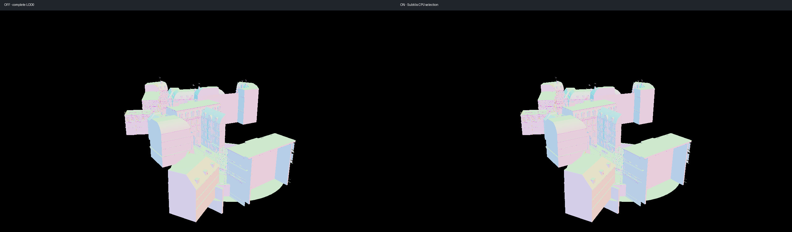
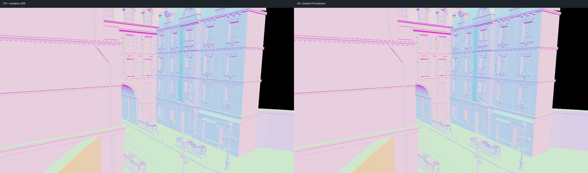

# Bistro：首轮真实 GPU 几何验收（2026-10-20）

完成近、远两个固定相机的 subtilis OFF/ON 对照。真实粗层已被消费、两组 Vulkan 校验均干净，图像差异较小；**尚无稳定性能收益证据，也不是完整纹理场景验收**。

## 资产、许可与处理

Amazon Lumberyard Bistro，Amazon Lumberyard / NVIDIA ORCA，2017，原始资产 [CC BY 4.0](https://developer.nvidia.com/orca/amazon-lumberyard-bistro)。使用 [zeux/niagara_bistro](https://github.com/zeux/niagara_bistro) 的 glTF 编辑版本：tree `2bdb6a410f8ebd475d3737e7c8e038ed2b00b02e`，bistro.gltf blob `83bc8307a00dd54b0fa2fdb10cc890b2955c8b0e`，bistro.bin blob `f6c918e6e5fa9b0f0dc3b51d6b6be286783fb8c9`。描述 SHA256 见 asset-manifest.json。原文件、README 和 LICENSE 保留在 `D:/deren-assets/bistro`，没有把大资产提交到仓库。

原场景展开后4,209,006个三角形、2909个绘制对象，96盏点光源及1盏方向光。初次运行正确触发 visibility 的1024项上限，OFF/ON 均整帧回退，因此这些图不能证明 subtilis 效果；日志保存在 bistro-*-unmerged.log.gz。

使用仓库 scripts/measure/prepare_bistro_geometry.py 制作静态测试副本：烘焙节点 TRS/矩阵，逆转置变换法线，镜像时调整绕序，按材质合并，保留所有4,209,006个三角形、UV及材质分区。脚本检查三角形数和索引范围，输出254个材质项，180,854,920字节几何缓冲。没有扩大 ID 或 GPU 表容量。

上游纹理采用当前导入器不能直接读取的 DDS。测试副本移除了纹理、动画和灯光，保留基姿态，使用常量材质并清除无纹理条件下的常量自发光。本轮输出**世界法线图**，用来观察几何/法线变化；MASK 材质仍受最细层策略保护，但无 alpha 纹理，不能验收真实镂空轮廓。截图属于上述资产的改编渲染，保留本节署名与来源。

## 配置与结果

RTX4060 Laptop GPU，NVIDIA617.42，Release，1280×720，离屏32帧，validation开启，TAA/FXAA/shadow/SSAO/bloom关闭。OFF与ON始终使用同一份预构建层级及上传数据，仅切换 subtilis。远景相机 `35,18,140,0,-83.071,0`，近景 `35,8,42,0,-88,0`。每组独立启动，不是长时间稳态性能基准。

| 指标 | 远景 | 近景 |
|---|---:|---:|
| visibility 实际记录项 | 251 | 246 |
| 原 LOD0 三角形 → 选中三角形 | 4,208,625 → 3,827,525 | 4,029,461 → 3,384,370 |
| 选中量减少（包含视锥剔除） | 9.06% | 16.01% |
| 实际选中的 coarse 记录 | 6523 | 4126 |
| fallback 项 | 0 | 0 |
| 变化像素占全图 | 0.25217% | 0.00868% |
| 每像素RGB最大通道差的全图均值，8bit | 0.02294 | 0.00090 |
| 通道差>4的像素占比 | 0.06380% | 0.00315% |
| 最大通道差，8bit | 206 | 179 |
| 黑色背景阈值前景掩码差异像素 | 0 | 0 |
| 校验/警告/错误 | 0 | 0 |

变化以少量局部像素为主；零前景掩码差异不等于严格几何/深度误差保证，较大的最大差也说明个别法线/边缘像素并非完全相同。没有观察到整片缺失或破碎，但两张静态截图不足以覆盖全部接缝和运动切换。

GPU session平均31帧：远景 OFF28.40ms、ON复测27.16ms，第一次ON曾为30.47ms；近景 OFF25.48ms、ON25.38ms。波动与差值同量级，不能宣称提速；这些 GPU 数字不包含 CPU 选层代价，也不能把剔除与简化的总减量当成纯LOD收益。后续需固定温度/频率、预热、交错多轮和独立 CPU/GPU 统计。

所有 WebP 为无损导出，并与截图逐像素核对。原始PNG与未压缩日志位于 build-release-dyn-clang64/bistro-probe；配置、压缩原始日志和 results.json 在本目录。

## 测试发现并修复的应用越界

原灯光导入以运行时128盏上限判断，却向只有4项的 gui.point_lights 写入。Bistro 的96盏点光导致访问异常，诊断地址定位到 main 的灯光位置写入，pre-fix-exception.txt 保留证据。修复为按 std::size(gui.point_lights) 截断，并纠正日志与注释。

移除临时入口和全部异常诊断、恢复正式构建后，再用未合并的96灯光场景运行：4盏保留、92盏安全截断、截图成功、validation干净（light-regression.log.gz）。这是实际资产的 RED→GREEN 回归证据。方向光仍按既有应用策略忽略，没有擅自增加 GUI 灯槽。

## 复现与边界

1. 获取上述上游 glTF及两个bin，放在同一目录；无需下载DDS纹理。本机原件在 D:/deren-assets/bistro。
2. 使用带 NumPy 的 Python：`python scripts/measure/prepare_bistro_geometry.py D:/deren-assets/bistro/bistro.gltf D:/deren-assets/bistro/bistro-merged.gltf`。
3. 本次导入构建/统计是**临时验收补丁** acceptance-only.patch，未合入生产 runtime。复现时先 `git apply --check` 再应用；构建 deren，给测试进程设置 DEREN_BISTRO_BUILD=1。补丁仅在创建 primitive 时生成显式 built_geometry，并补记 coarse 数。OFF/ON 都保留此环境变量。
4. 按本目录 far/near-off/on.toml 的配置运行 `deren --config <配置绝对路径> --capture-frames 32 --capture-camera=<上述对应相机>`。路径需按本机资源目录调整；camera与frame数必须保持一致。
5. 测试完成清除环境变量、反向应用补丁并重新构建。当前工作区已经完成这些恢复，生产 runtime 没有残留测试入口或统计。

恢复生产代码后，完整 Release 构建（12线程）、CTest57/57、文档测试1/1和 diff --check 通过。原始测试输出见 final-ctest.log.gz。

本轮仅保留灯光边界修复、资产准备脚本和本报告证据。完整材质/alpha纹理、TAA、resize、移动相机距离序列、组合 character-forward、长时间性能与 CPU 选择成本仍待验收；不能宣称 M1b 全部完成。
