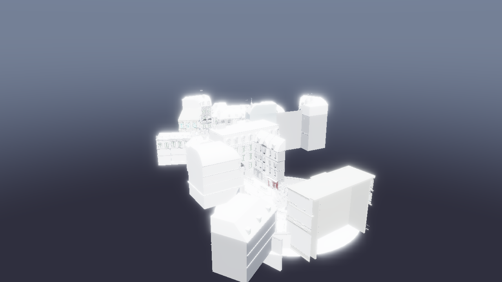
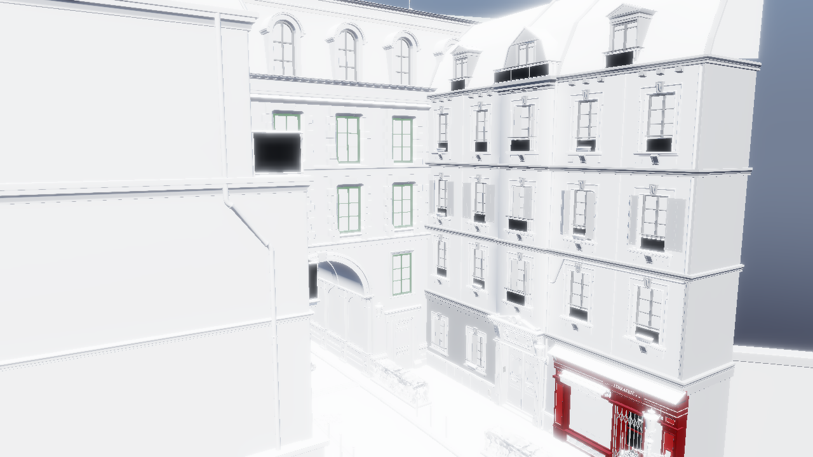

# Runtime cluster DAG Object LOD 验收（2026-10-22）

真实资产已由离线 converter 接入 loader → engine 验证/共享 → GPU generation → 逐帧 DAG cut。
目标 1px、validation 关闭的三轮中位数：far GPU **−17.8%**，near **−12.9%**；并行 cut 墙钟约 **1.2ms/帧**。
代价是 import-ready 约多 **1.25s**、进程峰值工作集约多 **139MiB**。
**源资产例外**：本 Bistro 原有 glTF 规范错误，派生/转换未新增；近景还存在很小的 OFF 像素波动。
这些限制没有被清洗或当成零错误，见 §5/§6。最终文档/回归/whole-change review 由 Task 8 收口。

## 1. 资产、环境、二进制身份

- 原资产 `bistro-geometry.gltf`：6006 nodes、2909 实例、4,209,006 实例三角形；551 个 primitive 声明 TANGENT。
- 派生严格只删除这些 TANGENT 声明并重定位 buffer URI；其余 JSON 和 buffer 字节保持原样。原文件未修改。
- converter：506 converted、45 skipped、158 LOD0-only；348 个 unique DAG 被 runtime 采用为 2149 实例（1801 cache hits）。594 实例作 LOD0-only 回退；另 166 实例原样加载无 payload。
- 12 线程转换墙钟 **7.125s**，输出 **128,862,912B**，`validate --full` PASS。CLI 线程预算不等同于每 primitive 的报告并发：此多 primitive 任务的单 primitive `plannedConcurrency` 最大为 1。
- AMD Ryzen 7 7745HX with Radeon Graphics；NVIDIA GeForce RTX 4060 Laptop GPU, 617.42, 8188 MiB；Windows-11-10.0.26300-SP0。正式矩阵期间未并行构建或转换。

| 身份 | SHA-256 |
| --- | --- |
| 原 JSON | `982c5d635e057b4a1f9e2d649c6573da7cf05f1a6544a8e08a2df2b0ecb8c1c4` |
| 派生 JSON | `895c7e8fe74859f1cfe4ea86a94d39d4aa2df97453f586beb71b23547516d354` |
| cooked GLB | `620f424239909d023b30dd86fe953c579298a39ef2d4706bca59fc0d2982085b` |
| converter | `3778aa6e5c7be72240735166f4adbcf6fa8277a627b0110d67263d7d35f6edae` |
| renderer（本矩阵） | `1f033d4233810b5e55e2bc714f4b21325313fbb4aee5aed380b255646a65a86c` |

[资产 manifest](2026-10-21-object-lod/asset-manifest.json)、[环境/DLL hashes](2026-10-21-object-lod/environment.json)。

## 2. 导入与内存

validation 关闭、各三次 3-frame 基线：

| 指标 | OFF 中位数 | ON 中位数 |
| --- | --- | --- |
| import-ready 墙钟 | 4.209s | 5.459s |
| 3-frame 整进程墙钟 | 15.028s | 18.087s |
| 峰值 CPU 工作集 | 702.77MiB | 841.40MiB |

import-ready 从进程启动量到首条 `imported N primitives` 日志可读，包含设备/环境/资源初始化；50ms 轮询精度，**不是纯 payload 解码耗时**。
工作集是 OS 进程采样到的峰值指标，不是 GPU 显存。130-frame 整进程 far OFF/ON 为 18.00/20.68s，near 为 19.11/20.42s；启动成本使短进程总墙钟没有变快。

## 3. CPU cut

validation 关闭的三轮中位数：

| 相机 | worker 工作总和/帧 | 并行墙钟/帧 | 工作/物体 | CPU active OFF → ON |
| --- | --- | --- | --- | --- |
| far | 5.325ms | 1.245ms | 1.833us | 4.08 → 5.34ms |
| near | 4.916ms | 1.202ms | 1.731us | 4.55 → 5.23ms |

8-worker 池、每帧按 item 分片；无额外嵌套池。cut 计时在 `gpu_timings=true` 下收集每 120 帧的 session average；工作计时包含 prepare/记录写入，墙钟还含历史、调度、等待和发布。
各 worker 工作可以重叠，不能拿 5ms 的工作总和当作主线程停顿。两个时钟采样/物体的观察开销未扣除。禁用 GPU timings 时不作物体级计时。

## 4. 帧时间、三角形与容量

1280×720、130 frames/次、OFF/ON 各三次交错；shadow/TAA/SSAO/bloom/FXAA 关闭，visibility 开，目标 1px，hysteresis 关闭。
far 相机 `35,18,140,0,-83.07,0`；near `35,8,42,0,-88,0`。

| 相机 | validation | GPU OFF → ON ms | GPU 下降 | 稳态 wall OFF → ON ms | CPU active OFF → ON ms |
| --- | --- | --- | --- | --- | --- |
| far | OFF | 24.46 → 20.11 | 17.8% | 21.74 → 18.21 | 4.08 → 5.34 |
| far | ON | 24.18 → 20.65 | 14.6% | 21.70 → 18.36 | 15.05 → 14.08 |
| near | OFF | 21.33 → 18.58 | 12.9% | 19.42 → 16.39 | 4.55 → 5.23 |
| near | ON | 22.17 → 18.19 | 18.0% | 19.61 → 16.56 | 14.66 → 13.56 |

GPU 为 129-frame session average；稳态 wall 为最后一个完整日志窗口的 `seconds/frames`，时间窗口不同，不能逐项相减。CPU active 为最后 60-frame `total - pace`。

- far：4,208,625 → 3,318,617 triangles（−21.15%）；50,808 → 41,030 records。
- near：3,626,626 → 2,860,109 triangles（−21.14%）；43,930 → 35,444 records。

- far 可见 2906 items，near 2840；场景 2909。表占用 **50,815/65,536（77.54%）**，最大 run **1395/4096**；所有正式轮次 cut/容量回退均为 **0**。
- 594 次导入回退是已知 LOD0-only，不是 cut 容量不足。wire/profile/material/source/DAG/item/table 导入失败均为 0。
- host 写入量：far **2,294,912B/帧**，near **2,019,392B/帧**，包括 item 与选择记录。

逐轮表（每行两次捕获，合计 24 次；validation 0/1 = 关闭/开启）：

| 相机 | validation | round | GPU OFF / ON ms | wall OFF / ON ms | ON cut wall ms |
| --- | --- | --- | --- | --- | --- |
| far | 0 | 1 | 24.12 / 19.85 | 21.74 / 18.21 | 1.194 |
| far | 0 | 2 | 24.46 / 20.11 | 21.49 / 18.36 | 1.276 |
| far | 0 | 3 | 24.46 / 21.16 | 21.74 / 18.18 | 1.245 |
| far | 1 | 1 | 25.19 / 19.82 | 22.44 / 18.55 | 1.213 |
| far | 1 | 2 | 24.18 / 20.76 | 21.70 / 18.36 | 1.206 |
| far | 1 | 3 | 23.84 / 20.65 | 21.70 / 18.36 | 1.213 |
| near | 0 | 1 | 21.33 / 18.58 | 19.62 / 16.39 | 1.113 |
| near | 0 | 2 | 21.42 / 19.05 | 19.42 / 16.56 | 1.202 |
| near | 0 | 3 | 21.33 / 18.27 | 19.42 / 16.39 | 1.205 |
| near | 1 | 1 | 22.55 / 18.35 | 19.42 / 16.72 | 1.134 |
| near | 1 | 2 | 22.11 / 18.14 | 19.61 / 16.29 | 1.102 |
| near | 1 | 3 | 22.17 / 18.19 | 19.62 / 16.56 | 1.138 |

[全部逐轮元数据](2026-10-21-object-lod/measurements.json)、[重算结果](2026-10-21-object-lod/results.json)。

## 5. 图像差异与重复性

原资产 OFF、TANGENT-stripped OFF、cooked OFF 在同一 far 相机均 **0 changed pixels**，validation clean。
ON/OFF 的六对同相机比较（两种 validation × 三轮）：

| 相机 | changed pixels 最小/中位/最大 | 中位比例 | mean channel delta 中位（0–255） | max channel delta |
| --- | --- | --- | --- | --- |
| far | 10974 / 10974 / 10974 | 1.191% | 0.016540 | 86 |
| near | 3926 / 6483 / 6578 | 0.703% | 0.005250 | 65 |

far OFF/ON 各自六次像素完全一致。near OFF/ON 各有两种像素 hash：OFF 自身最大 2901px、mean delta 0.001223、max 10；ON 自身最大 2847px、mean 0.001207、max 10。
**不宣称 near 帧逐字节确定，也不把全部差异归因于 LOD**；所有轮次 CPU cut 数量/三角形一致，完整 pairwise 结果在 JSON 中。波动根因未在本阶段调查。

| 相机 | OFF | ON |
| --- | --- | --- |
| far |  |  |
| near |  |  |

预览为无损 WebP；像素统计来自归档的原始 PNG。

## 6. 验证与源资产例外

- 正式矩阵、加载基线和探针：Vulkan validation **零 error/warning/VUID**；converter `validate --full` PASS。
- 当前 converter 生成的 `cross_dag`、`seam`、`lod0_only`：固定 SHA 的官方 Khronos validator 均 **0 error / 0 warning**；另见[已接受 converter 记录](2026-10-21-subtilis-converter.md)。
- **本 Bistro 不满足 Khronos-clean 门禁**：original 28,930 errors；删除 TANGENT 声明后 derived/cooked 都为 **2673 errors / 0 warnings**，逐条 `(code,pointer,message)` 完全相同，新增 **0**。
- 其余原有问题：34 个 emissive 范围错误、98 个未声明 `KHR_lights_punctual`、2541 个非有限 accessor float。维持既定派生规则，没有静默规范化材料或几何/metadata。
- 这证明本次没有新增 core-validator 发现，**不等于本资产通过 core validator**。GLB/扩展格式的零错误证据来自上面的独立 fixture/既有 converter 验收；真实源资产清理仍是独立工作。

[validator 对照](2026-10-21-object-lod/khronos-comparison.json)、[fixture 结果](2026-10-21-object-lod/khronos-fixtures.json)；完整原始报告在 D: 归档。
新增捕获观察入口 `DEREN_CLUSTER_PROBE_DUMP` 仅在截图帧、显式环境开关下写出实际 CPU run，不修改算法、表或 draw metadata。
Release 全量 **61/61**（99.71s），CI 形态 ASan/UBSan headless **60/60**（232.95s）；native PE boundary 由 Release 覆盖。默认 sanitizer 构建 Vulkan DLL 会链接失败，已按仓库既有 CI 约束只构建 headless targets，没有扩大抑制。

## 7. M2 决策输入

| 既定触发项 | 本次观测 | 判断 |
| --- | --- | --- |
| GPU <15ms 且 cut >=2.5ms；或 cut 占 CPU active >=25% | GPU 18.58–20.11ms；cut wall 1.20–1.24ms；占 active 22.99–23.31% | 中位数未触发，active 比例已接近阈值 |
| visible >=3200 或 scene >4096 | 2906 peak，scene 2909 | 未触发 |
| 持续 run 回退或表 >=65536 | 0；50815/65536，max item 1395 | 未触发 |
| host 写入接近 3,604,480B 上限 | far 2,294,912B，near 2,019,392B | 约 63.7%/56.0% |

关键路径采用并行 wall；把 worker 工作总和与单线程 active 相除会混淆不同口径。本次不据此立即启动 M2；CPU reference、item 身份/排序和整项回退契约必须保留。

## 8. M4 重探针与联合决策

每个 dump 的 item/record/triangle 总数都与 renderer 的实际选中 run 相等；depth 尺寸/有限范围校验通过，投影中心落在已绘制几何上超过 99%。

| 相机 | 实际 cut 簇数（HZB 候选） | <1px 直径 | <2px 直径 | 簇视锥剔除 | 离线 HZB 保守遮挡下界 |
| --- | --- | --- | --- | --- | --- |
| far | 41,030 | 23.28% | 38.23% | 0.00% | 0.73% |
| near | 35,444 | 5.37% | 15.95% | 1.88% | 36.22% |

矩阵未启用 GPU HZB；遮挡列是同帧深度的离线潜在量，不是已实现的 GPU launch 收益。
相对 M1b 的 far <1px 22.05%、near 3.09%，比例略升，但总体候选更少；应同时看绝对 workload，不能只凭比例启动软件光栅。

联合决策输入：当前 32-bit id 仍容纳本场景，暂无实测依据切换 64-bit；若 M2 采用稳定 cluster 身份或表需求增长，再与两级 item/meshlet 表一起定编码。
M4 的 storage depth twin 必须结合 subpixel workload、实测 GPU/HZB 收益、格式带宽和同步一起评估；本阶段不改 id/resolve/depth，也不设计 M4。

[far probe](2026-10-21-object-lod/probe-far.json)、[near probe](2026-10-21-object-lod/probe-near.json)。

## 9. 限制、归档与复现

仅本机/单驱动、固定两相机与 1px；未测 2px、开启迟滞的收益、纹理场景或 streaming。全驻留、static OPAQUE；M2/M4/M5 未实现。
主要限制包括源资产既有 Khronos 错误、near 像素轻微波动、启动/驱动缓存抖动；短进程总墙钟不等同于稳态帧吞吐。

大文件归档：`D:/deren-assets/2026-10-21-object-lod/`，191 文件逐个 SHA-256；[完整 manifest](2026-10-21-object-lod/sha256-manifest.json)。工作区 staging 的成功副本与归档 hash 已核对。
原生 converter 在本次 D: 暂存创建失败，改用工作区 staging 后校验拷贝；原文件/转换器代码未修改。仓库只留约 0.87MB 摘要与无损预览。

```powershell
# 重算归档（不重跑 renderer，逐项核对原始日志）
python scripts/measure/analyze_object_lod.py D:/deren-assets/2026-10-21-object-lod/runtime/measurements.json --report-data --original-image D:/deren-assets/2026-10-21-object-lod/runtime/controls/original-off.png
python scripts/measure/analyze_object_lod.py --self-test
# 新的空 work 目录中重跑；保留每一轮，不覆盖历史证据
python scripts/measure/measure_object_lod.py --work build-release-dyn-clang64/object-lod-repro
```

分析脚本拒绝缺轮次/重复轮次/失败/短捕获/非有限或缺失指标；已有数值须与原始日志一致。新增统计用 `--refresh-metrics` 从日志补全，原始 measurements 副本保留。
